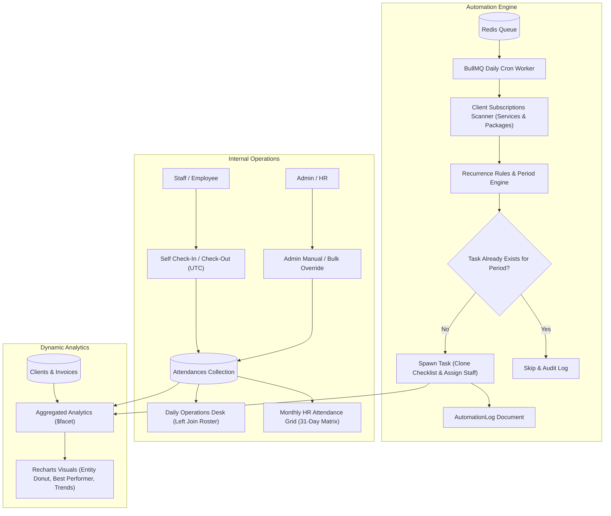

# Proactive SaaS — Phase 2: Automation Engine & Internal Operations
## Backend Micro-Phase Architecture Plan (Phases 49–70)

> **Context:** Phase 2 Evolutionary Scope — Automation Engine, Background Jobs, Attendance Tracking & Dynamic Analytics.  
> **Source Documents:** [`Requirement.md` (Modules 1.3, 4, 8, 10, 13)](file:///c:/Users/hp/Desktop/Proactive/Backend/docs/Requirement.md), [`MVPs.md` (Sprint 3, 5 & Roadmap)](file:///c:/Users/hp/Desktop/Proactive/Backend/docs/MVPs.md), [`readme.md` (Phase 2)](file:///c:/Users/hp/Desktop/Proactive/readme.md).  
> **Stack:** Node.js · Express.js · TypeScript · MongoDB (Mongoose) · BullMQ · Redis · Recharts (Frontend).  
> **Target Status:** 0% Pending → Production Ready with Comprehensive Integration Tests.

---

## 1. Architectural Overview

Phase 2 transforms Proactive from a manual practice management record-keeper into an **automated operational engine**. It introduces background queue processing with **BullMQ** and **Redis**, recurring task auto-spawning from client subscriptions, staff attendance tracking (daily desk & monthly payroll matrix), and real-time visual analytics.



---

## 2. Phase Breakdown & Feature Matrix

| Part | Phase | Title | Primary Endpoints | Core Responsibility |
|---|---|---|---|---|
| **Part 10** | **49** | Holiday Model & Multi-Tenant Calendar | `POST /api/v1/holidays`<br>`GET /api/v1/holidays` | Tenant-scoped holiday master for national & festive office closures. |
| | **50** | Holiday Read, Update & Deletion | `PUT /api/v1/holidays/:id`<br>`DELETE /api/v1/holidays/:id` | Manage holiday entries and validate date collision prevention. |
| | **51** | Working Days & Weekend Settings | `GET /api/v1/tenant-settings/work-days`<br>`PUT /api/v1/tenant-settings/work-days` | Configure tenant weekend days (e.g. Sunday or Sat/Sun) for payroll math. |
| **Part 11** | **52** | Attendance Schema & Fast Indexing | N/A (Mongoose Model) | Compound index `{ tenantId: 1, userId: 1, date: 1 }` and UTC timestamp schema. |
| | **53** | Self-Service Check-In & Check-Out | `POST /api/v1/attendance/check-in`<br>`POST /api/v1/attendance/check-out` | Staff real-time check-in/out, automatic duration and overtime computation. |
| | **54** | Daily Attendance Desk (Left-Join Roster) | `GET /api/v1/attendance/daily?date=YYYY-MM-DD` | `$lookup` aggregation showing ALL active staff with `-- \| --` if unlogged. |
| | **55** | Admin Attendance Entry & Overrides | `POST /api/v1/attendance/mark` | RBAC-protected manual attendance creation or modification for any user. |
| | **56** | Bulk Attendance Actions | `POST /api/v1/attendance/bulk` | Batch apply status (Holiday/Leave/Absent) to selected staff members. |
| **Part 12** | **57** | Monthly Attendance Matrix Aggregation | `GET /api/v1/attendance/monthly?month=MM&year=YYYY` | 31-day aggregated matrix grouped by user with weekend and holiday styling flags. |
| | **58** | Staff Attendance Summary & Payable Days | `GET /api/v1/attendance/summary/:userId` | Compute present days, half days, paid leaves, and payable days for payroll. |
| | **59** | Attendance Permissions & SBAC Control | Express Middleware | Restrict "Self" access roles from modifying other employees' attendance. |
| | **60** | Attendance Export Service | `GET /api/v1/attendance/export?month=MM&year=YYYY` | CSV/Excel stream of monthly attendance records for external payroll software. |
| **Part 13** | **61** | BullMQ & Redis Queue Setup | Internal Infrastructure | Queue connection with graceful error recovery and mock fallback for tests. |
| | **62** | Recurrence Rule & Period Calculation Engine | Pure Service Function | Mathematical period resolver: "Recently Completed" vs "Currently Running". |
| | **63** | Idempotent Task Generation Engine | Service Logic | Prevent duplicate task creation for same `(tenantId, clientId, serviceId, period)`. |
| | **64** | Daily Recurring Task Worker (BullMQ Job) | Background Queue Worker | Daily scheduled job scanning client service/package subscriptions and spawning tasks. |
| | **65** | Manual & On-Demand Automation Trigger API | `POST /api/v1/automation/trigger-tasks` | Admin endpoint to trigger task generation on demand with immediate progress feedback. |
| | **66** | Automation Audit Log & History API | `GET /api/v1/automation/logs` | Audit trail collection tracking execution timestamps, tasks created, and errors. |
| **Part 14** | **67** | Client Entity Distribution Aggregation | `GET /api/v1/analytics/client-distribution` | `$group` pipeline by `entityType` (Sole Prop, Pvt Ltd, LLP, Individual) for donut chart. |
| | **68** | Best Performer & Staff Leaderboard | `GET /api/v1/analytics/staff-performance` | Aggregation joining Users and Tasks, computing completion rate % and ranking. |
| | **69** | Attendance KPI Widget Aggregation | `GET /api/v1/analytics/attendance-overview` | Real-time presence %, total present, half-days, leaves across firm for dashboard. |
| | **70** | Unified Phase 2 Home Analytics Endpoint | `GET /api/v1/dashboard/overview` (Expanded) | Parallel MongoDB `$facet` combining invoicing, staff performance, attendance, and client charts. |

---

## 3. Detailed Phase Specifications

### Part 10: Holidays & Operational Calendar (Phases 49–51)

#### Phase 49: Holiday Model & Multi-Tenant Calendar
- **Goal:** Allow practice admins to define official office holidays (national holidays, festivals) for their organization.
- **Model:** `Backend/src/models/Holiday.ts`
  ```typescript
  export interface IHoliday extends Document {
    tenantId: mongoose.Types.ObjectId;
    name: string;
    date: string; // YYYY-MM-DD
    type: 'National' | 'Festival' | 'Optional' | 'Other';
    description?: string;
    createdAt: Date;
    updatedAt: Date;
  }
  ```
- **Indexes:** `{ tenantId: 1, date: 1 }` (unique compound index to prevent duplicate holiday entries on the same day).
- **Plugin:** Attach `tenantPlugin`.
- **Endpoints:**
  - `POST /api/v1/holidays`: Create holiday with Zod validation.
  - `GET /api/v1/holidays?year=YYYY`: Fetch holidays for a specific calendar year.
- **Test:** Create 2 holidays for Tenant A and Tenant B on the same date; verify multi-tenant isolation and duplicate rejection within Tenant A.

#### Phase 50: Holiday Read, Update & Deletion
- **Goal:** Enable updating and deleting existing holidays with validation.
- **Endpoints:**
  - `PUT /api/v1/holidays/:id`: Update name, type, or date.
  - `DELETE /api/v1/holidays/:id`: Delete holiday.
- **Test:** Create a holiday, update its name, and delete it. Verify it no longer appears in `GET /api/v1/holidays`.

#### Phase 51: Working Days & Weekend Settings
- **Goal:** Store tenant-level operational work days (e.g. `['Sunday']` or `['Saturday', 'Sunday']`) inside `TenantSettings`.
- **Schema Update:** `Backend/src/modules/masters/schemas/tenant-settings.schema.ts`
  ```typescript
  workingDays: {
    weekends: { type: [String], default: ['Sunday'] }, // ['Sunday'] or ['Saturday', 'Sunday']
    standardWorkHoursPerDay: { type: Number, default: 8.5 }
  }
  ```
- **Endpoints:**
  - `GET /api/v1/tenant-settings/work-days`: Fetch tenant weekend and work hours config.
  - `PUT /api/v1/tenant-settings/work-days`: Update weekend configuration.
- **Test:** Update weekends to `['Saturday', 'Sunday']` and verify subsequent attendance queries recognize both days as non-working.

---

### Part 11: Attendance Tracking & Self-Service Desk (Phases 52–56)

#### Phase 52: Attendance Schema & Fast Indexing
- **Goal:** Create an optimized, index-backed Attendance schema capable of handling millions of daily records across tenants.
- **Model:** `Backend/src/models/Attendance.ts`
  ```typescript
  export interface IAttendance extends Document {
    tenantId: mongoose.Types.ObjectId;
    userId: mongoose.Types.ObjectId;
    date: string; // YYYY-MM-DD format for fast exact matching
    status: 'Present' | 'Absent' | 'Half Day' | 'Leave' | 'Paid Leave' | 'Holiday';
    checkIn?: Date;  // UTC ISO Timestamp
    checkOut?: Date; // UTC ISO Timestamp
    totalMinutes?: number; // Total working duration
    overtimeMinutes: number; // Duration beyond standard work hours
    markedBy: mongoose.Types.ObjectId; // User who recorded the entry
    notes?: string;
    createdAt: Date;
    updatedAt: Date;
  }
  ```
- **Indexes:**
  - `{ tenantId: 1, userId: 1, date: 1 }` (unique: strictly one entry per employee per day).
  - `{ tenantId: 1, date: 1, status: 1 }` (for daily summary queries).
- **Test:** Verify unique compound constraint fails if inserting duplicate record for same `tenantId`, `userId`, and `date`.

#### Phase 53: Self-Service Check-In & Check-Out
- **Goal:** Allow staff members to clock in and clock out directly from their workspace dashboard.
- **Endpoints:**
  - `POST /api/v1/attendance/check-in`:
    - Checks if entry already exists for `today` (UTC YYYY-MM-DD). If exists with `checkIn`, return 400 (`ALREADY_CHECKED_IN`).
    - Creates attendance record with `status: 'Present'`, `checkIn: new Date()`, `markedBy: req.user._id`.
  - `POST /api/v1/attendance/check-out`:
    - Finds today's entry. If not found or `checkOut` already set, return 400.
    - Sets `checkOut: new Date()`.
    - Computes `totalMinutes = Math.round((checkOut - checkIn) / 60000)`.
    - If `totalMinutes < 240` (4 hours) -> sets `status: 'Half Day'`.
    - If `totalMinutes > standardWorkHours * 60` -> computes `overtimeMinutes`.
- **Test:** Simulate check-in at 09:00 UTC, check-out at 18:00 UTC; verify `status: 'Present'` and duration calculation.

#### Phase 54: Daily Attendance Desk (Left-Join Roster)
- **Goal:** Display the day-by-day operations roster showing **all active staff**, including those who have not checked in yet (`-- | --`).
- **Endpoint:** `GET /api/v1/attendance/daily?date=YYYY-MM-DD`
- **Implementation (MongoDB `$lookup` Pipeline):**
  ```typescript
  const dateStr = req.query.date || format(new Date(), 'yyyy-MM-dd');
  const roster = await User.aggregate([
    { $match: { tenantId: req.tenantId, isActive: true } },
    {
      $lookup: {
        from: 'attendances',
        let: { userId: '$_id' },
        pipeline: [
          {
            $match: {
              $expr: {
                $and: [
                  { $eq: ['$userId', '$$userId'] },
                  { $eq: ['$date', dateStr] },
                  { $eq: ['$tenantId', req.tenantId] }
                ]
              }
            }
          }
        ],
        as: 'attendance'
      }
    },
    {
      $project: {
        _id: 1,
        name: 1,
        username: 1,
        email: 1,
        roleId: 1,
        attendance: { $arrayElemAt: ['$attendance', 0] }
      }
    }
  ]);
  ```
- **Summary Metrics:** Compute totals for `Present`, `Half Day`, `Absent`, `Leave`, `Unmarked`.
- **Test:** With 3 active users (User A checked in, User B on Leave, User C unlogged), verify response returns all 3 users with correct merged attendance objects.

#### Phase 55: Admin Attendance Entry & Overrides
- **Goal:** Enable authorized managers/admins to manually create or update attendance for any employee (e.g. retroactive sick leave or forgotten punch).
- **Endpoint:** `POST /api/v1/attendance/mark`
- **Validation (Zod):**
  - `userId`: string (valid Mongo ObjectId)
  - `date`: string (`YYYY-MM-DD`)
  - `status`: `'Present' | 'Absent' | 'Half Day' | 'Leave' | 'Paid Leave' | 'Holiday'`
  - `checkIn`: optional ISO date string
  - `checkOut`: optional ISO date string
  - `notes`: optional string
- **Test:** Admin marks "Paid Leave" for an employee on a past date; verify record is created and markedBy is set to Admin's user ID.

#### Phase 56: Bulk Attendance Actions
- **Goal:** Apply a single status (e.g. "Holiday", "Paid Leave", "Absent") to multiple staff members simultaneously via a single request.
- **Endpoint:** `POST /api/v1/attendance/bulk`
- **Validation:** `{ userIds: string[], date: string, status: string, notes?: string }`
- **Execution:** Uses `bulkWrite` with `upsert: true` to efficiently batch write without race conditions.
- **Test:** Bulk mark 5 employees as "Leave"; verify all 5 records are created/updated in a single atomic database round-trip.

---

### Part 12: Monthly Attendance Grid & HR Analytics (Phases 57–60)

#### Phase 57: Monthly Attendance Matrix Aggregation
- **Goal:** Power the HR 31-day matrix view displaying employees on the Y-axis and days 1–31 on the X-axis.
- **Endpoint:** `GET /api/v1/attendance/monthly?month=MM&year=YYYY`
- **Implementation:**
  - Query all attendance documents where `date` starts with `YYYY-MM-` for `req.tenantId`.
  - Fetch tenant weekend settings from `TenantSettings` and holiday list from `Holidays`.
  - Group attendance records by `userId` into a fast key-value map: `{ [userId]: { [day]: { status, checkIn, checkOut } } }`.
- **Test:** Call for month with 30 days and 2 registered holidays; verify response contains complete matrix and holiday badges.

#### Phase 58: Staff Attendance Summary & Payable Days
- **Goal:** Calculate payroll statistics for an employee over a selected month.
- **Endpoint:** `GET /api/v1/attendance/summary/:userId?month=MM&year=YYYY`
- **Math Engine:**
  - `totalDays`: Days in the month (e.g. 30).
  - `presentDays`: Count of `Present` records.
  - `halfDays`: Count of `Half Day` records (`* 0.5`).
  - `paidLeaves`: Count of `Paid Leave` records.
  - `holidays`: Count of weekend + official holiday days.
  - `payableDays`: `presentDays + (halfDays * 0.5) + paidLeaves + holidays`.
  - `attendancePercentage`: `((presentDays + halfDays * 0.5) / (totalDays - holidays)) * 100`.
- **Test:** User with 20 present days, 2 half days, 1 paid leave, and 8 weekend/holidays -> verify `payableDays = 30` and `attendancePercentage = 100%`.

#### Phase 59: Attendance Permissions & SBAC Control
- **Goal:** Enforce strict RBAC and Scope-Based Access Control so regular employees cannot mark or view other employees' attendance.
- **Rules:**
  - Role with `attendance.manage`: Can mark for anyone, view monthly grid, and trigger bulk updates.
  - Role with `attendance.view_self`: Can only check in/out for themselves and view their own monthly history. Attempting to pass another `userId` returns `403 Forbidden`.
- **Test:** User with "Self" scope attempts `POST /api/v1/attendance/mark` for a colleague; assert HTTP 403.

#### Phase 60: Attendance Export Service (CSV/Excel)
- **Goal:** Export monthly attendance data formatted for payroll software (Tally, Keka, GreytHR).
- **Endpoint:** `GET /api/v1/attendance/export?month=MM&year=YYYY`
- **Output:** Streamed CSV file with columns: `Employee Name`, `Username`, `Present`, `Half Day`, `Absent`, `Paid Leave`, `Payable Days`, `Overtime (Hrs)`.
- **Test:** Generate export for month; verify CSV headers and correct row calculations.

---

### Part 13: BullMQ Automation Engine & Recurring Tasks (Phases 61–66)

#### Phase 61: BullMQ & Redis Queue Setup
- **Goal:** Establish a robust background job processing pipeline using BullMQ and Redis with automatic reconnection and test fallbacks.
- **Files:**
  - `Backend/src/config/redis.ts`: Redis connection with retry strategy and environment variables (`REDIS_HOST`, `REDIS_PORT`, `REDIS_PASSWORD`).
  - `Backend/src/queues/task-automation.queue.ts`: Queue initialization and worker registration.
- **Resilience:** Gracefully logs and avoids crashing the server if Redis is unavailable in local testing environments.
- **Test:** Dispatch a sample test job to the queue, process it in worker, and verify completion event.

#### Phase 62: Recurrence Rule & Period Calculation Engine
- **Goal:** Pure business logic service resolving when a task should be spawned and what string its `period` field should hold.
- **File:** `Backend/src/services/recurrence.service.ts`
- **Frequencies Supported:**
  - `Monthly`: (e.g. GST-3B, TDS deduction)
  - `Quarterly`: (e.g. GSTR-1 quarterly, Advance Tax)
  - `Yearly`: (e.g. ITR Filing, Annual Audit)
- **Period Math Logic:**
  - *Recently Completed Period:* If run on 2026-02-01 with Monthly frequency -> Period = `"Jan 2026"`.
  - *Currently Running Period:* If run on 2026-02-01 with Monthly frequency -> Period = `"Feb 2026"`.
  - Quarterly math: `"Q1 (Apr-Jun) 2026"`, `"Q2 (Jul-Sep) 2026"`, etc.
- **Due Date Math:** Computes exact `dueDate` from service's `dueDay` setting (e.g. 20th of the month).
- **Test:** Unit test running period math against all frequencies with edge-case months (January/February, leap years).

#### Phase 63: Idempotent Task Generation Engine
- **Goal:** Guarantee that a recurring compliance task is **never spawned twice** for the same client, service, and period, even if the worker runs multiple times.
- **Idempotency Key:** `{ tenantId, clientId, serviceId, period }`.
- **Algorithm:**
  1. Check if `Task.findOne({ tenantId, clientId, serviceId, period })` exists.
  2. If found, skip and log as `Already Spawned`.
  3. If not found, clone service checklist and custom fields, resolve assignee (Client default user vs Service override user), and insert new `Task`.
- **Test:** Run the generation function twice back-to-back with the same parameters; verify only 1 task document exists in MongoDB.

#### Phase 64: Daily Recurring Task Worker (BullMQ Job)
- **Goal:** Scheduled background worker executing daily at `00:00 UTC` (or configurable cron) across all active tenants.
- **Process Flow:**
  1. Iterate all active `Organization` tenants.
  2. Find all active `Client` records where `subscribedServices.length > 0` or `subscribedPackages.length > 0`.
  3. For each subscribed service:
     - Check if today matches the service's `creationDay` (or `daysBeforeDue`).
     - Calculate target period string.
     - Execute idempotent task generation.
  4. Track execution statistics: `{ tenantsProcessed, tasksCreated, tasksSkipped, errors }`.
- **Test:** Trigger worker in test environment with 2 clients; verify tasks are automatically created with correct checklists.

#### Phase 65: Manual & On-Demand Automation Trigger API
- **Goal:** Allow firm administrators to trigger the recurrence engine immediately from the UI without waiting for midnight.
- **Endpoint:** `POST /api/v1/automation/trigger-tasks`
- **Options:** Optional `{ clientId?, serviceId? }` filters for selective generation.
- **Response:** Returns immediate execution summary:
  ```json
  {
    "success": true,
    "data": {
      "scannedClients": 15,
      "tasksCreated": 8,
      "tasksSkipped": 7,
      "details": [...]
    }
  }
  ```
- **Test:** Call endpoint via admin token; assert returns 200 with generated tasks list.

#### Phase 66: Automation Audit Log & History API
- **Goal:** Provide practice owners with full transparency into every automated background run.
- **Model:** `Backend/src/models/AutomationLog.ts`
  ```typescript
  export interface IAutomationLog extends Document {
    tenantId: mongoose.Types.ObjectId;
    runType: 'Cron' | 'Manual';
    triggeredBy?: mongoose.Types.ObjectId;
    startedAt: Date;
    completedAt: Date;
    tasksCreatedCount: number;
    tasksSkippedCount: number;
    errorCount: number;
    details: Array<{
      clientId: mongoose.Types.ObjectId;
      serviceId: mongoose.Types.ObjectId;
      period: string;
      status: 'Created' | 'Skipped' | 'Failed';
      reason?: string;
    }>;
  }
  ```
- **Endpoint:** `GET /api/v1/automation/logs?page=1&limit=20`
- **Test:** Run task generator; verify an `AutomationLog` document is saved and queryable via the API.

---

### Part 14: Dynamic Visual Analytics & BI Aggregations (Phases 67–70)

#### Phase 67: Client Entity Distribution Aggregation
- **Goal:** Supply high-speed aggregated breakdown of the client base by legal entity structure for semi-donut chart visualization.
- **Endpoint:** `GET /api/v1/analytics/client-distribution`
- **Pipeline:**
  ```typescript
  const distribution = await Client.aggregate([
    { $match: { tenantId: req.tenantId, isActive: true } },
    { $group: { _id: '$entityType', count: { $sum: 1 } } },
    { $sort: { count: -1 } }
  ]);
  ```
- **Output:** Array of `{ entityType: 'Private Limited', count: 18, percentage: 42 }`.
- **Test:** Seed 10 Sole Proprietorships and 5 LLPs; verify exact counts and percentages in API response.

#### Phase 68: Best Performer & Staff Leaderboard
- **Goal:** Power the gamified staff performance leaderboard widget on the dashboard.
- **Endpoint:** `GET /api/v1/analytics/staff-performance?from=...&to=...`
- **Aggregation Pipeline:**
  - Join `Users` (active staff) with `Tasks` assigned to them.
  - Compute `totalAssigned = count()`.
  - Compute `completed = count(status == 'Completed')`.
  - Calculate `completionPercentage = (completed / totalAssigned) * 100`.
  - Sort by `completionPercentage: -1, completed: -1`.
- **Test:** Assign 5 tasks to User A (completed 4) and 5 to User B (completed 2); verify User A ranks #1 with 80% completion.

#### Phase 69: Attendance KPI Overview Aggregation
- **Goal:** Deliver aggregated attendance metrics for the practice owner's home dashboard widget.
- **Endpoint:** `GET /api/v1/analytics/attendance-overview?date=YYYY-MM-DD`
- **Metrics Calculated:**
  - `totalStaff`: Total active employees.
  - `presentToday`: Count of `Present` records today.
  - `halfDayToday`: Count of `Half Day` records today.
  - `onLeaveToday`: Count of `Leave` / `Paid Leave` records today.
  - `absentToday`: Count of `Absent` records today.
  - `presenceRate`: Percentage of staff present today.
- **Test:** Seed attendance records for 10 staff members; verify response matches exact mathematical counts.

#### Phase 70: Unified Phase 2 Home Analytics Endpoint
- **Goal:** Update `GET /api/v1/dashboard/overview` to combine all Phase 1 and Phase 2 aggregated analytics into a single high-performance payload with zero waterfall requests.
- **Endpoint:** `GET /api/v1/dashboard/overview`
- **Parallel Queries Execution:**
  - Invoicing & Receivables (`Invoice` dues, `Task` unbilled).
  - Client Entity Breakdown (`Client` `$group`).
  - Staff Performance Leaderboard (`Task` + `User`).
  - Attendance Status Summary (`Attendance` today).
  - Upcoming Holidays (`Holiday` where `date >= today` limit 5).
- **Test:** Call unified endpoint; assert single response contains all 5 widget payloads in under 150ms.

---

## 4. File Structure for Phase 2 Implementation

```
Backend/src/
├── models/
│   ├── Holiday.ts                 # Phase 49 (Holiday Master)
│   ├── Attendance.ts              # Phase 52 (Daily/Monthly Attendance)
│   └── AutomationLog.ts           # Phase 66 (Job Execution Audit Trail)
├── config/
│   └── redis.ts                   # Phase 61 (BullMQ Redis Connector)
├── queues/
│   └── task-automation.queue.ts   # Phase 61, 64 (BullMQ Queue & Worker)
├── services/
│   ├── holiday.service.ts         # Phase 49-50
│   ├── attendance.service.ts      # Phase 53-58 (Attendance Math & Aggregations)
│   ├── recurrence.service.ts      # Phase 62-63 (Period Math & Idempotent Generation)
│   └── analytics.service.ts       # Phase 67-70 (MongoDB Aggregation Pipelines)
├── controllers/
│   ├── holiday.controller.ts      # Phase 49-50
│   ├── attendance.controller.ts   # Phase 53-60
│   ├── automation.controller.ts   # Phase 65-66
│   └── analytics.controller.ts    # Phase 67-70
├── routes/
│   ├── holiday.routes.ts          # Mounts /api/v1/holidays
│   ├── attendance.routes.ts       # Mounts /api/v1/attendance
│   ├── automation.routes.ts       # Mounts /api/v1/automation
│   └── analytics.routes.ts        # Mounts /api/v1/analytics
├── tests/
│   └── phase49_70.test.ts         # Full Comprehensive Integration Test Suite
└── app.ts                         # Route Registrations
```

---

## 5. Testing & Verification Strategy

Each micro-phase is accompanied by automated Jest tests in [`Backend/src/tests/phase49_70.test.ts`](file:///c:/Users/hp/Desktop/Proactive/Backend/src/tests/phase49_70.test.ts):

1. **Holiday Calendar Isolation:** Multi-tenant collision tests and date sorting.
2. **Attendance Timekeeping:** UTC time calculation, check-in duplicate prevention, and automated half-day thresholding.
3. **Monthly Matrix & Left-Join:** Verify every employee appears on daily roster even with zero activity.
4. **Idempotent Task Generation:** Assert that recurring jobs never duplicate tasks for identical periods.
5. **Period Math Edge Cases:** Verify December-to-January transitions and quarterly calculations.
6. **Analytics Pipeline Accuracy:** Validate Recharts data structures, percentages, and `$facet` performance.
