# Proactive SaaS — Phase 2: Frontend Micro-Phase Architecture Plan
## Web Application Implementation Specification (Phases F-49 to F-70)

> **Context:** Phase 2 Frontend Architecture for Automation Engine, Operational Calendar, Attendance Tracking & Dynamic BI Analytics.  
> **Complements:** [`Backend/docs/Phase_2_mircro_phase.md`](file:///c:/Users/hp/Desktop/Proactive/Backend/docs/Phase_2_mircro_phase.md) (Phases 49–70).  
> **Source Documents:** [`Requirement.md`](file:///c:/Users/hp/Desktop/Proactive/Backend/docs/Requirement.md) (Modules 1.3, 4, 8, 10, 13), [`MVPs.md`](file:///c:/Users/hp/Desktop/Proactive/Backend/docs/MVPs.md) (Sprint 3, 5), [`readme.md`](file:///c:/Users/hp/Desktop/Proactive/readme.md).  
> **Target Application Root:** [`application/`](file:///c:/Users/hp/Desktop/Proactive/application) (Next.js 16 App Router · React 19 · TypeScript · Tailwind CSS v4 · Redux Toolkit / RTK Query · Recharts · Radix UI · Lucide Icons · Sonner).  
> **Target Status:** 0% Initialized → Complete Production Implementation Blueprint.

---

## 1. Architectural Overview & Design System

The Phase 2 frontend elevates the Proactive practice management suite from a static CRM/billing portal into a **reactive, real-time internal operations desk and business intelligence powerhouse**.

```mermaid
graph TD
    subgraph Operations & Attendance
        TopBar["TopBar Punch Widget"] -->|POST /attendance/check-in| API[(Backend API)]
        DailyDesk["/attendance (Daily Desk)"] -->|GET /attendance/daily| API
        Matrix["/attendance/matrix (31-Day Grid)"] -->|GET /attendance/monthly| API
        SummaryDrawer["Employee Summary Drawer"] -->|GET /attendance/summary/:id| API
        ExportBtn["CSV Stream Downloader"] -->|GET /attendance/export| API
    end

    subgraph Operational Settings
        HolidayPage["/settings/holidays"] -->|CRUD /holidays| API
        SeedBtn["Statutory Seed Button"] -->|POST /holidays/seed-default| API
        WorkDaysPage["/settings/working-days"] -->|PUT /tenant-settings/work-days| API
    end

    subgraph Automation Engine Hub
        AutoPage["/tasks/automation"] -->|GET /automation/logs| API
        TriggerModal["Trigger Automation Modal"] -->|POST /automation/trigger-tasks| API
    end

    subgraph Dynamic BI Analytics
        Dashboard["Dashboard (/) & /analytics"] -->|GET /dashboard/overview| API
        Donut["Client Entity Donut (Recharts)"] -->|GET /analytics/client-distribution| API
        Leaderboard["Staff Leaderboard Widget"] -->|GET /analytics/staff-performance| API
        AttKPI["Attendance KPI Overview"] -->|GET /analytics/attendance-overview| API
    end
```

### 1.1. Core Tech Stack & Guidelines
- **Framework:** Next.js 16 with React 19 and App Router (`application/app/(app)/...`).
- **State Management & Network Layer:** Redux Toolkit with **RTK Query** (`application/lib/services/api.ts`). Zero ad-hoc `axios`/`fetch` calls; all endpoints use RTK Query hooks with automatic cache invalidation tags (`Holiday`, `Attendance`, `TenantSettings`, `AutomationLog`, `Analytics`).
- **Styling:** Tailwind CSS v4 with unified design tokens (glassmorphism cards, vibrant accents, dark/light contrast, micro-animations via `framer-motion`).
- **Icons & Primitives:** `lucide-react` for icons; `@radix-ui/react-*` for dialogs, popovers, tabs, dropdowns, and tooltips.
- **Data Visualization:** `recharts` for animated donuts, bar graphs, and sparklines.
- **Toasts & Feedback:** `sonner` for non-blocking feedback with status icons.

---

## 2. Master Feature Matrix (Phases F-49 to F-70)

| Part | Phase | Title | Primary Route / Component | Core UI Deliverables |
|---|---|---|---|---|
| **Part 10** | **F-49** | Holiday Calendar Master View | `/settings/holidays` | Calendar year picker, holiday data table, badge tags (National, Festival, Other), and creation modal. |
| | **F-50** | Holiday Edit, Delete & Statutory Seed | `/settings/holidays` Modal | Inline editing, delete dialog with collision checks, and 1-click statutory national holiday seeder button. |
| | **F-51** | Working Days & Alternate Weekend Config | `/settings/working-days` | Day pills selector, standard daily hours slider, and 2nd/4th Saturday toggle switch. |
| **Part 11** | **F-52** | Attendance Store, Types & Geolocation Hook | `application/lib/hooks/useGeolocation.ts` | RTK Query attendance endpoints, GPS Haversine verification hook, and geofence status indicator. |
| | **F-53** | Self-Service Web Punch Widget | `TopBar.tsx` / Dashboard | Live clock, Check-In / Check-Out toggle button, duration counter, notes popup, and GPS status pill. |
| | **F-54** | Daily Attendance Desk (Operations Roster) | `/attendance` | Date navigator, stats counter cards, and Left-Join roster table showing every employee with `-- \| --` placeholder. |
| | **F-55** | Admin Manual Attendance Entry Modal | `/attendance` Modal | Row action modal to manually set Present, Half Day, Absent, or Paid Leave with time pickers and overtime calc. |
| | **F-56** | Bulk Attendance Actions Toolbar | `/attendance` Batch Bar | Multi-select employee checkboxes, floating batch action bar, and bulk mark modal capped at 250 staff. |
| **Part 12** | **F-57** | 31-Day Monthly Attendance Matrix Grid | `/attendance/matrix` | Full 31-day horizontal scroll matrix with sticky employee columns, color badges, department filter, and pagination. |
| | **F-58** | Staff Summary & Payable Days Drawer | `/attendance/matrix` Drawer | Slide-over drill-down detailing present days, half days, holidays, payable days calculation, and overtime hours. |
| | **F-59** | Attendance SBAC & Role Permission Gating | `components/shared/PermissionGate.tsx` | Strict deny-by-default guarding: hide manual overrides and colleagues for "Self-Only" staff; team scoping. |
| | **F-60** | One-Click Payroll CSV Export Downloader | `/attendance/matrix` Header | Header export button with month/year picker and direct Node.js streaming download handling. |
| **Part 13** | **F-61** | Automation RTK Query API & State Slices | `application/lib/services/api.ts` | RTK Query endpoints for manual task trigger and audit log queries with real-time poll/refresh. |
| | **F-62** | Client Recurrence Cadence Indicators | `/services` & `/clients` | Visual badge chips (Monthly, Calendar Quarter, Indian FY Q1–Q4, Yearly) with "Next Run" preview. |
| | **F-63** | On-Demand Task Automation Trigger Modal | `/tasks/automation` Action | "Run Automation Now" modal with confirmation, immediate execution progress spinner, and task spawn toast. |
| | **F-64** | Automation Audit Log & History Table | `/tasks/automation/logs` | Searchable execution history table showing timestamp, trigger source, spawned count, duration, and error trace. |
| | **F-65** | Automation Failure Diagnostic Drawer | `/tasks/automation/logs` Drawer | Slide-over inspector displaying stack trace, failed client IDs, and retry suggestions for audit log errors. |
| | **F-66** | Automation Settings & Cron Status Card | `/settings/automation` | Visual status card showing BullMQ daily worker health, Redis queue status, and midnight execution window. |
| **Part 14** | **F-67** | Client Entity Distribution Donut Chart | `application/components/analytics/...` | Animated Recharts donut chart with interactive hover tooltip and breakdown of entity types (Sole Prop, Pvt Ltd, LLP, Individual). |
| | **F-68** | Best Performer & Staff Leaderboard Widget | `application/components/analytics/...` | Top 3 podium cards with rank badges, completion rate % bar, and expandable full firm leaderboard table. |
| | **F-69** | Attendance KPI Overview Widget | `application/components/analytics/...` | Real-time presence ring indicator with breakdown badges (Present, Half Day, Leave, Absent, Unmarked). |
| | **F-70** | Unified Executive Home Dashboard Integration | `application/app/(app)/page.tsx` | Responsive dynamic dashboard assembling all Phase 2 analytics widgets, date filter, and glassmorphic UI. |

---

## 3. Detailed Specifications per Micro-Phase

---

### Part 10: Holidays & Operational Calendar (Phases F-49 to F-51)

#### Phase F-49: Holiday Calendar Master View
- **User Story:** As an Office Admin, I want to view all declared office holidays for a given year in a clean, filterable table so that my firm can plan operational closures.
- **Target Files:**
  - `application/lib/services/api.ts`: Add `getHolidays` query and `createHoliday` mutation.
  - `application/app/(app)/settings/holidays/page.tsx`: Main Holiday settings page.
  - `application/components/holidays/HolidayTable.tsx`: Data table component.
  - `application/components/holidays/CreateHolidayModal.tsx`: Creation modal.
- **Key UI Elements:**
  - Calendar Year Dropdown selector (`2025`, `2026`, `2027`).
  - Data table with columns: Date (`YYYY-MM-DD` and formatted `DD MMM YYYY`), Holiday Name, Type Badge (National: Purple, Festival: Orange, Optional: Blue, Other: Slate), Description, Actions.
  - "Add Holiday" modal with inputs: Name, Date picker, Type select, Description.
- **Integration Contract:**
  - `GET /api/v1/holidays?year=2026` -> returns `IHoliday[]`.
  - `POST /api/v1/holidays` with body `{ name, date, type, description }`.
- **Verification:** Create a holiday for 2026-10-02 (Gandhi Jayanti). Confirm it instantly renders in the table with proper badge.

---

#### Phase F-50: Holiday Edit, Delete & Statutory Seed Button
- **User Story:** As an Office Admin, I want to edit or delete holidays, or pre-populate official Indian statutory holidays with a single click, so I don't have to manually type national closures.
- **Target Files:**
  - `application/lib/services/api.ts`: Add `updateHoliday`, `deleteHoliday`, `seedDefaultHolidays` mutations.
  - `application/components/holidays/EditHolidayModal.tsx`: Inline edit modal.
  - `application/components/holidays/DeleteHolidayDialog.tsx`: Confirmation alert dialog.
  - `application/components/holidays/SeedHolidaysButton.tsx`: Quick action button.
- **Key UI Elements:**
  - Action menu on each row: Edit (pencil icon) and Delete (trash icon).
  - Header button: **"Seed Statutory Holidays"** (with Sparkles/Flag icon). Clicking displays a confirmation modal: *"This will pre-populate Republic Day, Independence Day, Gandhi Jayanti, May Day, and Christmas for 2026."*
  - Optimistic toast notifications via `sonner`.
- **Integration Contract:**
  - `PUT /api/v1/holidays/:id` with updated payload.
  - `DELETE /api/v1/holidays/:id`.
  - `POST /api/v1/holidays/seed-default?year=2026&region=national` -> returns `{ seededCount: 5 }`.
- **Verification:** Click "Seed Statutory Holidays"; verify 5 national holidays appear immediately without page refresh.

---

#### Phase F-51: Working Days & Alternate Weekend Settings UI
- **User Story:** As a Practice Manager, I want to configure our standard working days, weekend closures, and alternate Saturdays (e.g., 2nd & 4th Saturday off) so payroll and attendance calculate accurately.
- **Target Files:**
  - `application/lib/services/api.ts`: Add `getWorkingDays` and `updateWorkingDays` endpoints.
  - `application/app/(app)/settings/working-days/page.tsx`: Working days configuration page.
  - `application/components/settings/AlternateWeekendSelector.tsx`: Interactive selector component.
- **Key UI Elements:**
  - Day Pill Multi-Selector: Mon, Tue, Wed, Thu, Fri, Sat, Sun. Clicking toggles weekend off-days.
  - Standard Work Hours input slider / number box (e.g., `8.5` hours per day).
  - **Alternate Weekend Section:**
    - Switch toggle: *"Enable Alternate Weekend Rules"* (e.g. for banks/corporate CA firms).
    - Day select: *"Saturday"*.
    - Week Pills: `Week 1`, `Week 2` (active), `Week 3`, `Week 4` (active), `Week 5`.
  - Save Settings floating bar with dirty-state indicator.
- **Integration Contract:**
  - `GET /api/v1/tenant-settings/work-days` -> returns `{ weekends, standardWorkHoursPerDay, alternateWeekendRules }`.
  - `PUT /api/v1/tenant-settings/work-days` with `{ weekends: ['Sunday'], standardWorkHoursPerDay: 8, alternateWeekendRules: { day: 'Saturday', weeks: [2, 4] } }`.
- **Verification:** Select 2nd and 4th Saturday; click Save. Reload page and confirm settings persist.

---

### Part 11: Attendance Tracking & Self-Service Desk (Phases F-52 to F-56)

#### Phase F-52: Attendance Store, Types & Geolocation Verification Hook
- **User Story:** As a developer, I want a strongly-typed Redux API slice and a reusable GPS Geolocation hook with distance calculation so that web check-ins can enforce tenant office geofencing.
- **Target Files:**
  - `application/lib/types/attendance.ts`: TypeScript interfaces for `AttendanceRecord`, `DailyRosterItem`, `MonthlyMatrixDay`, `MonthlyMatrixResult`.
  - `application/lib/hooks/useGeolocation.ts`: Browser `navigator.geolocation` hook.
  - `application/lib/utils/haversine.ts`: Utility computing distance in meters between office lat/lng and user lat/lng.
- **Key Logic:**
  - `useGeolocation()` returns `{ coordinates: { lat, lng } | null, error, loading, requestLocation() }`.
  - Computes Haversine distance against tenant settings `officeLocation`. If distance > `geofenceRadiusMeters` (e.g., 150m), flags `isOutsideGeofence = true`.
- **Verification:** Unit test haversine calculation with sample coordinates in New Delhi; verify distance > 150m triggers warning flag.

---

#### Phase F-53: Self-Service Web Punch Widget
- **User Story:** As an Employee, I want a quick-punch widget on my TopBar and Dashboard to check in when I arrive at the office and check out when I leave.
- **Target Files:**
  - `application/components/layout/TopBar.tsx`: Integrate compact quick-punch button.
  - `application/components/attendance/WebPunchWidget.tsx`: Expanded card widget for dashboard.
  - `application/lib/services/api.ts`: Add `checkIn`, `checkOut`, and `getTodayAttendance` endpoints.
- **Key UI Elements:**
  - **Compact TopBar Widget:** Shows current status pill (Not Checked In: Gray, Checked In: Green with live timer `04:12:35`, Checked Out: Slate).
  - **Click Action Modal:**
    - Live UTC/Local clock.
    - GPS Geofence badge (Green Shield: *"Office Geofence Verified"* / Red Alert: *"Outside 150m Office Perimeter"*).
    - Notes text area (e.g. *"Working on GST client audits"*).
    - Primary CTA: **"Punch In"** / **"Punch Out"**.
- **Integration Contract:**
  - `GET /api/v1/attendance/today` -> returns `{ hasCheckedIn, hasCheckedOut, checkIn, checkOut, totalMinutes }`.
  - `POST /api/v1/attendance/check-in` with `{ date, timestamp, latitude, longitude, notes }`.
  - `POST /api/v1/attendance/check-out` with `{ date, timestamp, notes }`.
- **Verification:** Click "Punch In"; timer begins counting up. Reload page; widget displays active "Checked In" status.

---

#### Phase F-54: Daily Attendance Desk (Operations Roster)
- **User Story:** As an HR Manager or Practice Lead, I want a live daily operations roster showing every active staff member in the firm and their punch status for today (or any historical date).
- **Target Files:**
  - `application/app/(app)/attendance/page.tsx`: Daily attendance desk page.
  - `application/components/attendance/DailyRosterTable.tsx`: Full left-join roster table.
  - `application/components/attendance/DailyAttendanceStatsRibbon.tsx`: Top summary cards.
- **Key UI Elements:**
  - **Date Ribbon:** Date navigation (`< Today >` + mini calendar picker).
  - **Summary Metric Counters:** Total Staff (e.g. 45), Present (38), Half Day (2), On Leave (3), Absent (2), Unmarked (0).
  - **Left-Join Roster Table:**
    - Columns: Employee Avatar & Name, Department/Role, Status Badge, In Time, Out Time, Duration (Hrs/Mins), Overtime (Hrs), Marked By, Actions.
    - Unmarked staff display a subtle dashed badge `Unmarked` with `-- | --` for in/out times.
- **Integration Contract:**
  - `GET /api/v1/attendance/daily?date=YYYY-MM-DD` -> returns `DailyRosterResult`.
- **Verification:** Query roster for today; staff who haven't punched appear with blank times and `Unmarked` status.

---

#### Phase F-55: Admin Manual Attendance Entry Modal
- **User Story:** As an Admin, I want to manually mark or adjust attendance for any employee (e.g. when staff forgets to punch or was visiting a tax tribunal) with proper reason notes.
- **Target Files:**
  - `application/components/attendance/MarkAttendanceModal.tsx`: Admin override modal.
  - `application/lib/services/api.ts`: Add `markAttendance` mutation.
- **Key UI Elements:**
  - Modal triggered via row action button (Pencil / Clock icon) on Daily Desk or Matrix.
  - Fields:
    - Selected Employee (read-only with avatar).
    - Date picker (defaults to row date).
    - Status selector: `Present`, `Half Day`, `Absent`, `Paid Leave`, `Holiday`.
    - Check-in time & check-out time pickers.
    - Overtime minutes number field.
    - Notes / Reason input.
  - Save button with loading indicator and cache invalidation of daily and monthly rosters.
- **Integration Contract:**
  - `POST /api/v1/attendance/mark` with payload `{ userId, date, status, checkIn?, checkOut?, overtimeMinutes?, notes? }`.
- **Verification:** Manually mark an unmarked staff member as "Present"; row updates immediately in the roster table.

---

#### Phase F-56: Bulk Attendance Actions Toolbar
- **User Story:** As an Admin, I want to select multiple employees via checkboxes and apply a status (such as "Holiday" or "Paid Leave") in a single operation.
- **Target Files:**
  - `application/components/attendance/BulkAttendanceBar.tsx`: Floating bulk action bar.
  - `application/components/attendance/BulkAttendanceModal.tsx`: Bulk action dialog.
  - `application/lib/services/api.ts`: Add `bulkMarkAttendance` mutation.
- **Key UI Elements:**
  - Checkbox column on `DailyRosterTable` with "Select All" header checkbox.
  - Floating bottom action bar appears when >= 1 checkbox is selected:
    - Badge: *"X employees selected"* (Client-side cap at 250).
    - Quick actions: "Mark Present", "Mark Holiday", "Mark Leave", "More...".
  - Bulk confirmation modal with batch progress bar for large selections.
- **Integration Contract:**
  - `POST /api/v1/attendance/bulk` with `{ userIds: string[], date: string, status: string, notes?: string }`.
- **Verification:** Select 5 employees, apply "Paid Leave", verify all 5 rows update simultaneously.

---

### Part 12: Monthly Attendance Grid & HR Analytics (Phases F-57 to F-60)

#### Phase F-57: 31-Day Monthly Attendance Matrix View
- **User Story:** As an HR Manager, I want a complete 31-day visual calendar grid showing all employees and their daily attendance status to audit monthly attendance at a glance.
- **Target Files:**
  - `application/app/(app)/attendance/matrix/page.tsx`: Monthly matrix page.
  - `application/components/attendance/MonthlyMatrixGrid.tsx`: Virtualized matrix component.
  - `application/components/attendance/MatrixCell.tsx`: Individual cell renderer with status tooltips.
- **Key UI Elements:**
  - Month & Year selector dropdowns (e.g. "April 2026").
  - Department filter dropdown (`All Departments`, `Audit`, `Tax`, `Corporate Legal`).
  - **Horizontal Scroll Matrix Table:**
    - Sticky left column: Employee Name, Code, and Avatar.
    - 28 to 31 day columns (Days 1 to 31 with Day of Week header e.g. `1 Thu`, `2 Fri`, `3 Sat`).
    - Cell Badges:
      - `P` (Green, Present)
      - `HD` (Amber, Half Day)
      - `A` (Red, Absent)
      - `PL` (Blue, Paid Leave)
      - `W` (Slate background, Weekend closure)
      - `H` (Purple background, Official Holiday)
      - `--` (Light gray, Unmarked)
    - Clicking any cell opens the `MarkAttendanceModal` for that employee on that date.
- **Integration Contract:**
  - `GET /api/v1/attendance/monthly?month=MM&year=YYYY&departmentId=...&page=1&limit=50`.
- **Verification:** Switch to April 2026; verify Sundays and designated alternate Saturdays are shaded as weekends and national holidays are colored purple.

---

#### Phase F-58: Staff Summary & Payable Days Drawer
- **User Story:** As a Payroll Accountant, I want to click any employee in the matrix to view an itemized breakdown of their monthly payable days, holidays, and overtime hours.
- **Target Files:**
  - `application/components/attendance/StaffSummaryDrawer.tsx`: Slide-over drawer component.
  - `application/lib/services/api.ts`: Add `getStaffAttendanceSummary` endpoint.
- **Key UI Elements:**
  - Vaul / Radix Slide-Over Drawer opening from the right.
  - Employee Profile Header (Avatar, Name, Designation, Joining Date).
  - Metric Summary Grid:
    - Total Calendar Days (e.g. 30).
    - Present Days (e.g. 20).
    - Half Days (e.g. 2 = 1.0 day credit).
    - Paid Leaves (e.g. 1).
    - Weekends & Holidays Credit (e.g. 8).
    - **Total Payable Days:** Highlighted badge (e.g. `30.0 Days`).
    - Total Overtime: `4.5 Hours`.
  - Itemized day-by-day table showing punch-in, punch-out, and notes.
- **Integration Contract:**
  - `GET /api/v1/attendance/summary/:userId?month=MM&year=YYYY` -> returns `StaffAttendanceSummary`.
- **Verification:** Open drawer for an employee who joined mid-month; confirm payable days are correctly prorated from their joining date.

---

#### Phase F-59: Attendance SBAC & Role Permission Gating
- **User Story:** As an Admin, I want employees with "Self-Only" roles to only see their own attendance record and prevent them from viewing or modifying other staff members.
- **Target Files:**
  - `application/components/shared/PermissionGate.tsx`: Role guard wrapper.
  - `application/contexts/PermissionsContext.tsx`: Update with `attendance.manage` and `attendance.view_self`.
- **Key UI Behavior:**
  - If user only has `attendance.view_self`:
    - Daily Desk (`/attendance`) hides the multi-user roster and displays only the user's personal attendance log.
    - Bulk Attendance toolbar is hidden.
    - Monthly matrix restricts view to the user's own row or redirects to their personal history card.
    - Manual mark actions on other users are disabled and hidden.
- **Verification:** Login as staff with Self-Only role; confirm admin action buttons and colleague records are completely hidden.

---

#### Phase F-60: One-Click Payroll CSV Export Downloader
- **User Story:** As an HR Manager, I want to download a ready-to-import CSV of monthly attendance to upload directly to our payroll/accounting system.
- **Target Files:**
  - `application/components/attendance/ExportAttendanceButton.tsx`: Export button with stream trigger.
  - `application/lib/utils/download-stream.ts`: Direct browser streaming helper.
- **Key UI Elements:**
  - Header Button: **"Export Payroll CSV"** (with FileSpreadsheet / Download icon).
  - Clicking triggers a native browser download stream of `attendance-export-YYYY-MM.csv`.
  - Displays a brief loading spinner on the button while the stream initializes.
- **Integration Contract:**
  - `GET /api/v1/attendance/export?month=MM&year=YYYY` -> streams `text/csv` directly with `Content-Disposition: attachment`.
- **Verification:** Click export for April 2026; verify CSV file downloads immediately with valid column headers and row data.

---

### Part 13: BullMQ Automation Engine & Recurring Tasks (Phases F-61 to F-66)

#### Phase F-61: Automation RTK Query API & State Slices
- **User Story:** As a developer, I want a standardized RTK Query API slice for background automation triggers and logs so that all automation UI components share live cache states.
- **Target Files:**
  - `application/lib/types/automation.ts`: Types for `AutomationLogItem`, `AutomationTriggerResult`, `RecurrenceSchedule`.
  - `application/lib/services/api.ts`: Add `triggerTaskAutomation` mutation and `getAutomationLogs` query with invalidation tags.
- **Integration Contract:**
  - `POST /api/v1/automation/trigger-tasks` -> returns `{ triggered: boolean, tasksCreated, tasksSkipped, totalProcessed, executionTimeMs }`.
  - `GET /api/v1/automation/logs?page=1&limit=20` -> returns `{ logs: IAutomationLog[], total, pages }`.
- **Verification:** Call `triggerTaskAutomation` through RTK Query; verify execution summary returns successfully.

---

#### Phase F-62: Client Recurrence Cadence Indicators
- **User Story:** As an Account Manager, I want to see visual recurrence badges on Client Services and Packages indicating their automated billing and task schedule.
- **Target Files:**
  - `application/components/services/RecurrenceBadge.tsx`: Reusable cadence badge chip.
  - `application/app/(app)/services/page.tsx` and `application/app/(app)/clients/[id]/page.tsx`: Integrate recurrence chips.
- **Key UI Elements:**
  - Cadence Badges:
    - `Monthly` (Blue calendar icon)
    - `Quarterly (Calendar)` (Green icon, Jan/Apr/Jul/Oct)
    - `Quarterly (Indian FY)` (Purple icon, Q1: Apr–Jun, Q2: Jul–Sep, Q3: Oct–Dec, Q4: Jan–Mar)
    - `Yearly` (Amber icon)
  - Tooltip displays: *"Next automated task spawn: 1st of next period"*.
- **Verification:** View a client subscribed to GST Monthly and Advance Tax Indian FY; verify both badges render accurately.

---

#### Phase F-63: On-Demand Task Automation Trigger Modal
- **User Story:** As a Firm Administrator, I want a manual button to trigger the task generation engine on demand (e.g. after onboarding a new client batch) without waiting for the midnight cron.
- **Target Files:**
  - `application/components/automation/TriggerAutomationModal.tsx`: Action modal.
  - `application/app/(app)/tasks/automation/page.tsx`: Automation Hub overview page.
- **Key UI Elements:**
  - Header Action: **"Trigger Automation Engine"** (with Play / Zap icon).
  - Modal prompt: *"This will scan all active client package/service subscriptions for the current period and generate any missing tasks immediately."*
  - "Run Engine" button transitions into an animated scanning spinner with live elapsed timer.
  - Post-execution results card:
    - Tasks Created: `14` (Green)
    - Existing Tasks Skipped: `82` (Slate)
    - Errors: `0`
    - Execution Time: `1.24s`
- **Verification:** Click "Run Engine"; modal displays live execution results and triggers Sonner toast notification.

---

#### Phase F-64: Automation Audit Log & History Table
- **User Story:** As an IT/Admin Auditor, I want a historical log table tracking every automated background job run, its execution time, and generated task counts.
- **Target Files:**
  - `application/app/(app)/tasks/automation/logs/page.tsx`: Dedicated audit logs page.
  - `application/components/automation/AutomationLogsTable.tsx`: Searchable logs data table.
- **Key UI Elements:**
  - Filter bar: Date Range picker, Status filter (`All`, `Success`, `Partial`, `Failed`), Trigger Type (`Cron`, `Manual`).
  - Table Columns:
    - Execution Timestamp (`DD MMM YYYY, hh:mm:ss A`).
    - Trigger Source (Pill: `Scheduled Cron` in Blue / `Manual Trigger` in Purple with user name).
    - Status (Success: Green check, Failed: Red alert).
    - Tasks Created count pill.
    - Tasks Skipped count pill.
    - Execution Duration (e.g. `840 ms`).
    - Action: "View Diagnostic Log" button.
- **Verification:** Trigger an automation run; navigate to `/tasks/automation/logs` and verify the new execution log is row #1.

---

#### Phase F-65: Automation Failure Diagnostic Drawer
- **User Story:** As a System Administrator, I want to inspect error traces and failed client IDs when an automation job encounters an issue so I can resolve it immediately.
- **Target Files:**
  - `application/components/automation/AutomationDiagnosticDrawer.tsx`: Slide-over inspector drawer.
- **Key UI Elements:**
  - Slide-over drawer displaying raw JSON audit payload.
  - Formatted error section highlighting missing service templates, deleted client subscriptions, or validation exceptions.
  - "Copy Error Log" button.
  - "Retry Failed Task Generation" quick action.
- **Verification:** Simulate an automation run with an error; open drawer and verify error details render with syntax highlighting.

---

#### Phase F-66: Automation Settings & Engine Status Card
- **User Story:** As an Administrator, I want a status card in Settings confirming that the BullMQ queue and background worker are healthy and operational.
- **Target Files:**
  - `application/app/(app)/settings/automation/page.tsx`: Automation settings page.
  - `application/components/automation/QueueHealthCard.tsx`: Real-time health widget.
- **Key UI Elements:**
  - Health Card with pulsating status indicator:
    - Redis Queue: `Connected` (Green pulse).
    - BullMQ Daily Worker: `Active & Listening` (Green).
    - Next Scheduled Run: `Tonight at 00:00:00 UTC`.
    - Retention Policy: `90-day auto-purge TTL enabled`.
- **Verification:** Verify health card displays "Active" status when backend Redis is running.

---

### Part 14: Dynamic Visual Analytics & BI Dashboards (Phases F-67 to F-70)

#### Phase F-67: Client Entity Distribution Donut Chart Widget
- **User Story:** As a Partner, I want an interactive donut chart on our dashboard showing the proportion of clients by entity type (Sole Proprietorship, Pvt Ltd, LLP, Individual).
- **Target Files:**
  - `application/components/analytics/ClientEntityDonutChart.tsx`: Recharts donut chart component.
  - `application/lib/services/api.ts`: Add `getClientDistribution` query.
- **Key UI Elements:**
  - Card Header: *"Client Portfolio Distribution"* with total client count badge.
  - Recharts `PieChart` / `Pie` with responsive container, subtle inner radius (donut style), and curated color palette:
    - Private Limited: Deep Indigo (`#4F46E5`)
    - Sole Proprietorship: Emerald (`#10B981`)
    - LLP: Amber (`#F59E0B`)
    - Individual: Cyan (`#06B6D4`)
    - Partnership / Other: Violet (`#8B5CF6`)
  - Smooth hover scaling animation and custom glassmorphic tooltip showing count & percentage (`42% - 84 Clients`).
  - Interactive legend beneath chart.
- **Integration Contract:**
  - `GET /api/v1/analytics/client-distribution` -> returns `ClientDistributionItem[]`.
- **Verification:** Load dashboard; donut chart renders with animated sweep and interactive hover tooltips.

---

#### Phase F-68: Best Performer & Staff Leaderboard Widget
- **User Story:** As a Managing Partner, I want to see a ranked staff performance leaderboard highlighting task completion rates to reward productive team members.
- **Target Files:**
  - `application/components/analytics/StaffLeaderboardWidget.tsx`: Leaderboard card with podium.
  - `application/lib/services/api.ts`: Add `getStaffPerformanceLeaderboard` query.
- **Key UI Elements:**
  - **Top 3 Podium Display:**
    - 1st Place: Gold trophy icon, employee avatar, name, and completion rate badge (`98%`).
    - 2nd Place: Silver medal, avatar, and completion badge (`92%`).
    - 3rd Place: Bronze medal, avatar, and completion badge (`88%`).
  - **Ranked Table List:**
    - Columns: Rank (`#1`, `#2`, `#3`, `#4`), Employee Avatar & Name, Assigned Tasks, Completed Tasks, Progress Bar (`%`), Rank badge.
  - Date Range filter toggle (`This Month`, `Last Quarter`, `Financial Year`).
- **Integration Contract:**
  - `GET /api/v1/analytics/staff-performance?from=YYYY-MM-DD&to=YYYY-MM-DD` -> returns `StaffPerformanceItem[]`.
- **Verification:** Verify staff with highest completion rate occupies Rank #1 with Gold styling.

---

#### Phase F-69: Attendance KPI Overview Widget & Presence Ring
- **User Story:** As an Operations Manager, I want a real-time attendance overview widget on the dashboard showing today's attendance presence percentage and breakdown.
- **Target Files:**
  - `application/components/analytics/AttendanceKPIWidget.tsx`: Attendance KPI widget.
  - `application/lib/services/api.ts`: Add `getAttendanceOverview` query.
- **Key UI Elements:**
  - Header: *"Firm Attendance Today"* with date chip.
  - Optional Department Filter dropdown.
  - **Visual Circular Progress Ring:** Displays overall presence percentage (e.g. `92% Presence Rate`).
  - **Metric Pills Grid:**
    - Present: `36` (Green badge)
    - Half Day: `2` (Amber badge)
    - On Leave: `3` (Blue badge)
    - Absent: `1` (Red badge)
    - Unmarked: `3` (Slate badge)
- **Integration Contract:**
  - `GET /api/v1/analytics/attendance-overview?date=YYYY-MM-DD&departmentId=...` -> returns `AttendanceKPIOverview`.
- **Verification:** Select a specific department; presence ring and counts immediately re-aggregate for that department.

---

#### Phase F-70: Unified Executive Home Dashboard Integration
- **User Story:** As a Partner / SuperAdmin, I want a unified executive home dashboard that seamlessly combines all Phase 2 operational, attendance, and analytics widgets into a high-impact command center.
- **Target Files:**
  - `application/app/(app)/page.tsx`: Executive dashboard page.
  - `application/components/dashboard/DashboardHeader.tsx`: Date range & quick-action bar.
  - `application/components/dashboard/QuickStatsGrid.tsx`: Top summary cards.
- **Key UI Layout & Elements:**
  - **Top Quick-Stats Ribbon (4 Cards):**
    - Active Clients (with growth indicator).
    - Pending Tasks (with overdue badge).
    - Invoiced Revenue (with collection rate).
    - Team Attendance (with live presence rate).
  - **Middle Row Grid (2 Columns):**
    - Left (60% width): Unified Tasks & Subscriptions Activity feed with automation badges.
    - Right (40% width): `AttendanceKPIWidget` with Web Punch CTA.
  - **Bottom Row Grid (2 Columns):**
    - Left (50% width): `ClientEntityDonutChart` (Portfolio distribution).
    - Right (50% width): `StaffLeaderboardWidget` (Top performers podium).
  - **Aesthetic Excellence:** Glassmorphic card styling (`backdrop-blur-md bg-card/80 border`), micro-hover elevations, clean typography, dark-mode support, and zero placeholder text.
- **Integration Contract:**
  - `GET /api/v1/dashboard/overview` -> returns comprehensive aggregated payload.
- **Verification:** Load home page; all 4 widgets render concurrently with skeleton loaders and zero console errors.

---

## 4. Verification Checklist & Success Criteria

1. **Part 10 (Holidays & Weekends):**
   - [ ] Navigating to `/settings/holidays` displays 2026 holidays.
   - [ ] "Seed Statutory Holidays" imports Republic Day, Independence Day, Gandhi Jayanti, May Day, and Christmas with one click.
   - [ ] Alternate Saturday settings (2nd & 4th Saturday) persist and update attendance calendars.
2. **Part 11 (Attendance Tracking):**
   - [ ] TopBar punch button allows one-click check-in with live running timer.
   - [ ] Daily Desk displays every active employee, marking unpunched staff as `Unmarked` (`-- | --`).
   - [ ] Bulk actions allow selecting up to 250 staff to mark Leave or Holiday.
3. **Part 12 (Monthly HR Matrix):**
   - [ ] 31-day horizontal scroll matrix renders all employees with colored status badges.
   - [ ] Weekends and holidays are shaded and distinct from regular absences.
   - [ ] Clicking any employee opens the itemized Payable Days drill-down drawer.
   - [ ] CSV Export button triggers direct browser file download stream.
4. **Part 13 (Automation Engine Hub):**
   - [ ] `/tasks/automation` displays BullMQ queue health and recurrence cadence.
   - [ ] "Run Automation Now" triggers on-demand task spawning with instant progress feedback.
   - [ ] Historical audit logs table records every run with execution time and error traces.
5. **Part 14 (Visual Analytics):**
   - [ ] Recharts Client Entity Donut chart renders smoothly with tooltips.
   - [ ] Staff Leaderboard showcases top 3 podium performers with completion percentages.
   - [ ] Attendance KPI ring reflects live firm-wide presence rate.
   - [ ] Unified Executive Dashboard renders all components without layout shift or UI lag.
