# Proactive SaaS — Phase 3: Compliance & Asset Security
## Backend Micro-Phase Architecture Plan (Phases 71–95)

> **Context:** Phase 3 Evolutionary Scope — Digital Signature Certificates (DSC), Physical Token Custody, Credit Notes, Documents In-Out Register, Public Client Document Upload Links, and External GSTIN/PAN Verification.  
> **Source Documents:** [`Requirement.md` (Modules 6.11, 7.3, 9.1, 9.2, 10)](file:///c:/Users/hp/Desktop/Proactive/Backend/docs/Requirement.md), [`MVPs.md` (DSC & Physical Tracking)](file:///c:/Users/hp/Desktop/Proactive/Backend/docs/MVPs.md), [`readme.md` (Phase 3)](file:///c:/Users/hp/Desktop/Proactive/readme.md).  
> **Stack:** Node.js · Express.js · TypeScript · MongoDB (Mongoose Multi-Doc Transactions) · BullMQ · Redis · Multer · External Tax APIs.  
> **Target Status:** 0% Pending → Production Ready with Comprehensive Integration Tests.

---

## 1. Architectural Overview

Phase 3 transitions Proactive into an **enterprise-grade compliance and practice security suite**. It equips CA and accounting firms to securely manage client digital signature tokens (DSCs), issue legally compliant financial credit notes with multi-document ACID transactions, track physical client asset custody (original deeds, passbooks, seals), collect documents from clients via secure magic links without forcing client logins, and verify government credentials (PAN & GSTIN) directly via API adapters.

```mermaid
graph TD
    subgraph DSC & Physical Asset Custody
        DSCReg["DSC Token Inventory"] -->|Daily BullMQ Scan| DSCCron["DSC Expiry Scanner"]
        DSCCron -->|30 / 15 / 7 Days| Alert["Auto-Create Renewal Task & Client Alert"]
        DSCReg -->|Check In / Handover| HandoverLog["Token Movement Audit Trail"]
        DocInOut["Documents In-Out Register"] -->|Location & Custodian| OfficeCabinet["Physical Office Storage (Drawer / Safe)"]
        DocInOut -->|Overdue Return Check| ReturnAlert["Overdue Asset Return Alerts"]
    end

    subgraph Financial Adjustments Engine
        Inv["Finalized Invoices"] -->|Credit Request| CN["Credit Note Engine (ACID Transaction)"]
        CN -->|Reduce Balance Due| InvUpdate["Update Invoice amountDue & Status"]
        CN -->|Credit Stream| Ledger["Client Running Balance Ledger"]
        CN -->|Excess Credit| FutureAlloc["Allocate to Future Invoices / Cash Refund"]
    end

    subgraph Public Document Collection
        TaskStaff["Staff / Task Owner"] -->|Request Files| DocReq["Document Request Magic Link"]
        DocReq -->|Public No-Auth URL| ClientPortal["Client Public Upload Portal"]
        ClientPortal -->|Multipart Upload| Storage["Multer / Document Vault"]
        Storage -->|Fulfill Request| TaskUpdate["Notify Assignee & Mark Task Ready"]
    end

    subgraph External Compliance Verification
        GSTInput["Client GSTIN / PAN Input"] -->|Verify API| Adapter["Tax Authority API Adapter / Mock"]
        Adapter -->|Auto-Fill| ClientProfile["Client Profile Master (Trade Name, Address, Entity)"]
        Adapter -->|Verification Badge| Cache["Compliance Verification Log (30-Day Cache)"]
    end
```



---

## 2. Phase Breakdown & Feature Matrix

| Part | Phase | Title | Primary Endpoints | Core Responsibility |
|---|---|---|---|---|
| **Part 15** | **71** | DSC Model, Schema & Physical Token Register | N/A (Mongoose Model) | Multi-tenant DSC token schema tracking Class, Serial, Location, Issue & Expiry Dates. |
| | **72** | DSC Inventory CRUD & Directory APIs | `POST /api/v1/dsc`<br>`GET /api/v1/dsc`<br>`PUT /api/v1/dsc/:id`<br>`DELETE /api/v1/dsc/:id` | Filterable DSC directory with status pills (In Office, With Client, Expired). |
| | **73** | DSC Physical Handover & Movement Log | `POST /api/v1/dsc/:id/handover`<br>`GET /api/v1/dsc/:id/history` | Chain-of-custody tracking when physical USB tokens leave or enter the office. |
| | **74** | Automated DSC Expiry Scanner (BullMQ Job) | Background Queue Worker | Daily cron scanning DSCs expiring in 30, 15, and 7 days with idempotent alerts. |
| | **75** | DSC Auto-Renewal Tasks & Client Alerts | Event Handler Service | Auto-spawns "Renew DSC for [Client]" task and dispatches client reminder notifications. |
| **Part 16** | **76** | Credit Note Schema & Atomic Sequence Generator | N/A (Mongoose Model & Service) | Immutable financial credit note schema linked to original invoice with atomic number sequence (`CN-XXXX`). |
| | **77** | Atomic Credit Note Issuance (ACID Transaction) | `POST /api/v1/credit-notes` | MongoDB multi-document ACID transaction reducing invoice `amountDue` without mutating past invoices. |
| | **78** | Ledger Stream Integration & Chronological Recalc | `GET /api/v1/ledger/:clientId` (Updated) | Merges Credit Notes as credits (`-credit`) into chronological running balance ledger stream. |
| | **79** | Credit Note Read, Print & Analytics Adjustments | `GET /api/v1/credit-notes`<br>`GET /api/v1/credit-notes/:id` | Paginated credit notes listing, PDF view structure, and receivables dashboard reduction. |
| | **80** | Unallocated Credit Application & Cash Refunds | `POST /api/v1/credit-notes/:id/apply`<br>`POST /api/v1/credit-notes/:id/refund` | Allocate leftover credit notes to subsequent invoices or record audited bank refunds. |
| **Part 17** | **81** | Physical Documents In-Out Register Schema | N/A (Mongoose Model) | Schema tracking physical passbooks, deeds, and registration certificates in the office. |
| | **82** | Document In-Out Movement CRUD APIs | `POST /api/v1/docs-in-out`<br>`GET /api/v1/docs-in-out`<br>`PUT /api/v1/docs-in-out/:id` | Digital logbook recording Received and Given physical client records. |
| | **83** | Office Asset Storage Location Master | `GET /api/v1/docs-in-out/locations` | Tracking physical filing cabinets, shelf slots, and custodial staff members. |
| | **84** | Return Acknowledgment & Overdue Alerts | `POST /api/v1/docs-in-out/:id/return` | Mark return of physical documents; cron flagging returnable assets past due date. |
| | **85** | Document Register Export & Handover Slips | `GET /api/v1/docs-in-out/export` | CSV/Excel audit log and printable client handover acknowledgment receipts. |
| **Part 18** | **86** | Document Request Schema & Cryptographic Magic Links | N/A (Mongoose Model & Crypto) | Time-limited cryptographic URL token generator for public client document uploads. |
| | **87** | Document Request Creation & Magic Link Dispatch | `POST /api/v1/document-requests` | Generate upload checklist linked to tasks/clients and dispatch email notification. |
| | **88** | Public Non-Authenticated Upload API | `GET /api/v1/public/document-requests/:token`<br>`POST /api/v1/public/document-requests/:token/upload` | Secure non-auth portal endpoint with Multer validation (file type & size limits). |
| | **89** | Storage Linkage & Task Auto-Notification | Internal Storage Service | Catalogs files into client document repository and alerts assigned staff member. |
| | **90** | Request Lifecycle, Progress & Expiry Enforcement | `GET /api/v1/document-requests`<br>`POST /api/v1/document-requests/:id/resend`<br>`DELETE /api/v1/document-requests/:id` | Progress tracker (e.g. 3/4 files received), link revocation, and auto-expiry. |
| **Part 19** | **91** | Compliance Verification Adapter & Config Schema | N/A (Service & Tenant Config) | Configurable external API provider engine with Sandbox/Mock fallback for tests. |
| | **92** | PAN Verification API & Checksum Engine | `POST /api/v1/compliance/verify-pan` | Validates 10-digit PAN format, entity classification letter, legal name, and active status. |
| | **93** | GSTIN Public Verification & Search API | `POST /api/v1/compliance/verify-gstin` | Validates 15-digit GSTIN, state code, embedded PAN, trade name, and tax filing status. |
| | **94** | 1-Click Client Onboarding Auto-Fill Integration | `POST /api/v1/clients/auto-fill-from-gstin` | Auto-populates legal name, trade name, address, state, and pincode from GSTIN. |
| | **95** | Verification Cache, Badges & Compliance Audit Log | `GET /api/v1/compliance/logs` | 30-day cache saving API quota, verified badge persistence, and statutory audit logs. |

---

## 3. Detailed Phase Specifications

---

### Part 15: Digital Signature Certificate (DSC) Management & Expiry Automation (Phases 71–75)

#### Phase 71: DSC Model, Schema & Physical Token Register
- **Goal:** Provide a centralized multi-tenant data store for client USB token certificates (ePass2003, ProxKey, mToken, etc.) including physical storage location, certificate class, and validity windows.
- **Model:** `Backend/src/models/DSC.ts`
  ```typescript
  export interface IDSC extends Document {
    tenantId: mongoose.Types.ObjectId;
    clientId: mongoose.Types.ObjectId;
    certificateName: string; // e.g. "Rahul Chauhan - Director DSC"
    certificateClass: 'Class 2' | 'Class 3';
    tokenType: 'ePass2003' | 'ProxKey' | 'mToken' | 'Watchdata' | 'Other';
    tokenSerialNumber?: string; // USB dongle serial number
    issuingAuthority: 'eMudhra' | 'Capricorn' | 'Vsign' | 'Sify' | 'IDSign' | 'Other';
    issueDate: Date;
    expiryDate: Date;
    physicalLocation: string; // e.g. "Safe Box 1, Slot D-14"
    status: 'In Office' | 'With Client' | 'Expired' | 'Renewed';
    currentHolderName?: string; // If 'With Client' or out with staff
    alertMilestonesSent: ('30_day' | '15_day' | '7_day')[];
    notes?: string;
    createdBy: mongoose.Types.ObjectId;
    createdAt: Date;
    updatedAt: Date;
  }
  ```
- **Indexes:**
  - `{ tenantId: 1, clientId: 1 }`
  - `{ tenantId: 1, expiryDate: 1 }`
  - `{ tenantId: 1, status: 1 }`
- **Plugin:** Attach `tenantPlugin`.
- **Validation (Zod):** Validate date ranges (`expiryDate > issueDate`), valid token type, and non-empty physical location.

#### Phase 72: DSC Inventory CRUD & Directory APIs
- **Goal:** Provide complete RESTful endpoints to manage the practice's digital signature certificate inventory.
- **Endpoints:**
  - `POST /api/v1/dsc`: Log a newly received DSC token.
  - `GET /api/v1/dsc`: Paginated directory queryable by `clientId`, `status`, `expiringWithinDays` (e.g. `?expiringWithinDays=30`), `search` (name, serial, location).
  - `GET /api/v1/dsc/:id`: Fetch populated DSC document with client information and movement history.
  - `PUT /api/v1/dsc/:id`: Update certificate details, extend validity upon renewal, or update physical shelf slot.
  - `DELETE /api/v1/dsc/:id`: RBAC-protected soft deletion / decommission.
- **RBAC:** Requires `dsc.view`, `dsc.create`, `dsc.edit`, `dsc.delete`.

#### Phase 73: DSC Physical Handover & Movement Log
- **Goal:** Eliminate lost USB dongles by enforcing a digital chain of custody whenever a physical token is handed to a client, taken out for filing, or received back into the office.
- **Model:** `Backend/src/models/DSCHandoverLog.ts`
  ```typescript
  export interface IDSCHandoverLog extends Document {
    tenantId: mongoose.Types.ObjectId;
    dscId: mongoose.Types.ObjectId;
    action: 'Handed to Client' | 'Received from Client' | 'Internal Transfer';
    transferredToName: string; // Client contact person or staff member
    transferredToPhone?: string;
    reason: string; // e.g. "Required for MCA Annual Filing at client site"
    expectedReturnDate?: Date;
    receivedBackDate?: Date;
    handledByUserId: mongoose.Types.ObjectId;
    notes?: string;
    createdAt: Date;
  }
  ```
- **Endpoints:**
  - `POST /api/v1/dsc/:id/handover`: Record a token movement. If action is `Handed to Client`, automatically updates DSC status to `With Client` and sets `currentHolderName`. If `Received from Client`, resets status to `In Office`.
  - `GET /api/v1/dsc/:id/history`: Chronological audit trail of all physical handovers.

#### Phase 74: Automated DSC Expiry Scanner (BullMQ Job)
- **Goal:** A background job running daily at midnight scanning all active DSCs to identify certificates expiring within statutory renewal windows.
- **Queue & Worker:** `Backend/src/queues/dsc-expiry.queue.ts` & `Backend/src/queues/dsc-expiry.worker.ts`.
- **Business Logic:**
  - Computes target calendar dates: `today + 30 days`, `today + 15 days`, `today + 7 days`.
  - Queries active DSCs:
    ```typescript
    const expiringSoon = await DSC.find({
      tenantId,
      status: { $in: ['In Office', 'With Client'] },
      expiryDate: { $lte: targetMaxDate, $gte: today }
    });
    ```
  - Inspects `alertMilestonesSent` to ensure idempotency (never dispatches the same 30-day or 7-day notification twice).
  - Flags expired certificates (`expiryDate < today`) as status `'Expired'`.

#### Phase 75: DSC Auto-Renewal Tasks & Client Alerts
- **Goal:** Automatically convert expiring DSC detections into actionable revenue and workflow items.
- **Actions:**
  - Auto-spawns an internal task:
    - `title`: `"Renew DSC: ${dsc.certificateName} (${client.name})"`
    - `category`: `"Compliance / DSC Renewal"`
    - `dueDate`: DSC expiry date
    - `assignedUserId`: Client's default account manager or tenant admin
  - Dispatches an automated email notification via `nodemailer`:
    - Subject: `"Notice: Digital Signature Certificate Expiry Reminder — ${client.name}"`
    - Body: Outlines certificate serial, expiry date, and instructions for renewal.
  - Updates `alertMilestonesSent` on the DSC document.

---

### Part 16: Financial Adjustments: Credit Notes & Ledger Reconciliation (Phases 76–80)

#### Phase 76: Credit Note Schema & Atomic Sequence Generator
- **Goal:** Define the financial schema for legally compliant credit notes and implement atomic sequence numbering.
- **Model:** `Backend/src/models/CreditNote.ts`
  ```typescript
  export interface ICreditNoteItem {
    description: string;
    sacCode?: string;
    rate: number;
    quantity: number;
    amount: number;
    gstPercentage: number;
    cgst: number;
    sgst: number;
    igst: number;
    total: number;
  }

  export interface ICreditNote extends Document {
    tenantId: mongoose.Types.ObjectId;
    clientId: mongoose.Types.ObjectId;
    invoiceId: mongoose.Types.ObjectId; // Original invoice being credited
    creditNoteNo: string; // e.g. "CN-2026-001"
    date: Date;
    reason: 'Overcharge Correction' | 'Service Cancellation' | 'Goodwill Discount' | 'Deficiency of Service' | 'Other';
    items: ICreditNoteItem[];
    totals: {
      subtotal: number;
      taxTotal: number;
      cgstTotal: number;
      sgstTotal: number;
      igstTotal: number;
      roundOff: number;
      grandTotal: number;
    };
    unallocatedCredit: number; // Remaining amount if invoice had zero balance due
    status: 'Issued' | 'Applied' | 'Refunded' | 'Cancelled';
    notes?: string;
    createdBy: mongoose.Types.ObjectId;
    createdAt: Date;
    updatedAt: Date;
  }
  ```
- **Sequence Generator:** Update `Backend/src/services/sequence.service.ts` with `getNextCreditNoteNumber(tenantId, prefix = 'CN-', session)`.

#### Phase 77: Atomic Credit Note Issuance (ACID Transaction)
- **Goal:** Ensure financial immutability. When an invoice is credited, modify the linked invoice balance and credit note record atomically within a MongoDB transaction session.
- **Endpoint:** `POST /api/v1/credit-notes`
- **Validation Rules:**
  - Verify `invoiceId` belongs to the tenant and is not in `Cancelled` or `Draft` status.
  - Verify Credit Note `totals.grandTotal` does not exceed the invoice's original `totals.grandTotal` (prevent crediting more than billed).
- **Transaction Flow:**
  ```typescript
  const session = await mongoose.startSession();
  session.startTransaction();
  try {
    // 1. Generate next CN number
    // 2. Create CreditNote document
    // 3. Deduct linked invoice amountDue:
    //    adjustedDue = Math.max(0, invoice.totals.amountDue - creditNote.totals.grandTotal);
    //    unallocatedCredit = creditNote.totals.grandTotal - (invoice.totals.amountDue - adjustedDue);
    // 4. Update invoice.totals.amountDue and push creditNoteId to invoice.creditNoteIds
    // 5. If adjustedDue === 0, set invoice.status = 'Paid' (or 'Credited')
    await session.commitTransaction();
  } catch (error) {
    await session.abortTransaction();
  }
  ```

#### Phase 78: Ledger Stream Integration & Chronological Recalculation
- **Goal:** Seamlessly inject Credit Notes into the client's running balance ledger as credit entries.
- **Service:** Update `Backend/src/services/ledger.service.ts`.
- **Ledger Logic:**
  - Fetch Invoices (`debit = totals.grandTotal`, `credit = 0`).
  - Fetch Receipts (`debit = 0`, `credit = totalAmount`).
  - Fetch Credit Notes (`debit = 0`, `credit = totals.grandTotal`).
  - Sort all events chronologically by `date: 1, createdAt: 1`.
  - Recalculate running balance across every entry:
    $$\text{Running Balance} = \text{Previous Balance} + \text{Debit} - \text{Credit}$$
- **Endpoint:** `GET /api/v1/ledger/:clientId` outputs entries labeled `'Credit Note'` with `refNo = creditNoteNo` and linked `invoiceNo`.

#### Phase 79: Credit Note Read, Print & Analytics Adjustments
- **Goal:** Allow practice admins to search, view, download, and review credit notes, and adjust dashboard receivables.
- **Endpoints:**
  - `GET /api/v1/credit-notes`: Filter by `clientId`, `dateRange`, `status`.
  - `GET /api/v1/credit-notes/:id`: Full details populated with linked Invoice and Client details.
- **Dashboard Service Update:**
  - In `dashboard.service.ts`, adjust `totalReceivables` and revenue aggregations to deduct unallocated and issued credit notes from gross debtor balances.

#### Phase 80: Unallocated Credit Application & Cash Refunds
- **Goal:** Handle cases where a credit note was issued on an already-paid invoice, resulting in `unallocatedCredit > 0`.
- **Endpoints:**
  - `POST /api/v1/credit-notes/:id/apply`: Apply unallocated credit against another unpaid invoice of the same client. Atomic session reduces second invoice's `amountDue` and deducts `creditNote.unallocatedCredit`.
  - `POST /api/v1/credit-notes/:id/refund`: Record a formal cash/bank refund. Generates an audited payout record and balances the client's ledger account.

---

### Part 17: Documents In-Out Register & Client Asset Custody (Phases 81–85)

#### Phase 81: Physical Documents In-Out Register Schema
- **Goal:** Provide a digital registry to track physical client assets (hardcopy contract originals, property sale deeds, physical cheque books, company stamps) kept in the accounting office.
- **Model:** `Backend/src/models/PhysicalDocument.ts`
  ```typescript
  export interface IPhysicalDocument extends Document {
    tenantId: mongoose.Types.ObjectId;
    clientId: mongoose.Types.ObjectId;
    date: Date;
    category: 'Received' | 'Given'; // Received from client OR Given back/out
    documentType: 'Passbook' | 'Cheque Book' | 'Original Deeds' | 'PAN Card' | 'Registration Certificate' | 'Company Seal' | 'Other';
    documentName: string; // e.g. "Original Title Deed - Andheri Property"
    isReturnable: boolean;
    returnDate?: Date; // Expected return date if isReturnable is true
    actualReturnedDate?: Date;
    status: 'In Custody' | 'Returned' | 'Overdue';
    location: string; // e.g. "Storage Cabinet B, Shelf 3, Red Binder"
    custodianUserId: mongoose.Types.ObjectId; // Staff member who took custody
    receivedByPersonName?: string; // If 'Given', who physically took it
    receivedByPhone?: string;
    notes?: string;
    createdAt: Date;
    updatedAt: Date;
  }
  ```
- **Indexes:** `{ tenantId: 1, clientId: 1 }`, `{ tenantId: 1, status: 1 }`, `{ tenantId: 1, returnDate: 1 }`.

#### Phase 82: Document In-Out Movement CRUD APIs
- **Goal:** Enable office staff to log when physical assets are received from a client or given to third parties/banks.
- **Endpoints:**
  - `POST /api/v1/docs-in-out`: Log incoming or outgoing document. Enforces `returnDate` requirement if `isReturnable = true`.
  - `GET /api/v1/docs-in-out`: Filter by `clientId`, `category` (Received / Given), `status` (In Custody, Returned, Overdue), `isReturnable`, date range, and text search.
  - `GET /api/v1/docs-in-out/:id`: Detailed record with custody timeline.
  - `PUT /api/v1/docs-in-out/:id`: Edit metadata or update physical shelf location.

#### Phase 83: Office Asset Storage Location Master
- **Goal:** Provide an organized directory of physical storage units in the firm so staff can locate any client asset in seconds.
- **Endpoint:** `GET /api/v1/docs-in-out/locations`:
  - Returns aggregation of all distinct storage locations in use with item counts:
    ```json
    [
      { "location": "Cabinet A, Drawer 1", "activeCount": 14 },
      { "location": "Fireproof Safe, Shelf 2", "activeCount": 5 }
    ]
    ```

#### Phase 84: Return Acknowledgment & Overdue Alerts
- **Goal:** Prevent client disputes regarding original documents by recording return acknowledgments and flagging overdue unreturned items.
- **Endpoints & Worker:**
  - `POST /api/v1/docs-in-out/:id/return`: Mark asset as returned. Records `actualReturnedDate`, recipient signature/name, and transitions status to `'Returned'`.
  - BullMQ Daily Scanner: Inspects records where `status === 'In Custody'`, `isReturnable === true`, and `returnDate < today`. Automatically marks them `'Overdue'` and notifies the custodian staff member.

#### Phase 85: Document Register Export & Handover Slips
- **Goal:** Generate compliance handover slips for physical sign-off when returning original deeds to clients.
- **Endpoints:**
  - `GET /api/v1/docs-in-out/export`: Exports the firm's physical custody registry to CSV/Excel for annual audit.
  - `GET /api/v1/docs-in-out/:id/handover-slip`: Generates structured PDF/HTML handover receipt with signature lines for both client and firm partner.

---

### Part 18: One-Click Client Document Request & Public Upload Engine (Phases 86–90)

#### Phase 86: Document Request Schema & Cryptographic Magic Links
- **Goal:** Allow staff to request specific documents from clients without requiring clients to remember login credentials. Uses secure, time-limited cryptographic URL tokens.
- **Model:** `Backend/src/models/DocumentRequest.ts`
  ```typescript
  export interface IRequestedFileItem {
    name: string; // e.g. "Bank Statement FY 25-26"
    description?: string; // e.g. "PDF format from 1-Apr-2025 to 31-Mar-2026"
    isRequired: boolean;
    acceptedFormats: string[]; // ['.pdf', '.xlsx', '.csv', '.zip', '.png', '.jpg']
    uploadedDocumentId?: mongoose.Types.ObjectId;
    uploadedAt?: Date;
    status: 'Pending' | 'Uploaded' | 'Rejected';
  }

  export interface IDocumentRequest extends Document {
    tenantId: mongoose.Types.ObjectId;
    clientId: mongoose.Types.ObjectId;
    taskId?: mongoose.Types.ObjectId; // Optional task association
    requestNo: string; // e.g. "DREQ-1001"
    title: string;
    instructions?: string;
    token: string; // 64-char crypto hex string
    items: IRequestedFileItem[];
    expiresAt: Date; // Default 7 days from creation
    status: 'Pending' | 'Partially Uploaded' | 'Completed' | 'Expired' | 'Cancelled';
    createdBy: mongoose.Types.ObjectId;
    createdAt: Date;
    updatedAt: Date;
  }
  ```
- **Indexes:** `{ token: 1 }` (unique), `{ tenantId: 1, clientId: 1 }`, `{ expiresAt: 1 }`.

#### Phase 87: Document Request Creation & Magic Link Dispatch
- **Goal:** Staff creates a request checklist from a Task or Client page and dispatches an invitation link to the client.
- **Endpoint:** `POST /api/v1/document-requests`
- **Business Logic:**
  - Generates secure token: `crypto.randomBytes(32).toString('hex')`.
  - Builds upload link: `${FRONTEND_URL}/public/upload/${token}`.
  - Sends email to client via `nodemailer` with dynamic action button: *"Upload Required Documents for [Firm Name]"*.

#### Phase 88: Public Non-Authenticated Upload API
- **Goal:** Public-facing endpoint enabling clients to upload requested files cleanly from mobile or desktop with zero login friction.
- **Endpoints:**
  - `GET /api/v1/public/document-requests/:token`: Validates token, checks expiry, and returns public request metadata, requested items checklist, and tenant branding (Firm Name & Logo).
  - `POST /api/v1/public/document-requests/:token/upload`: Multipart upload with `multer`.
- **Security & Validation:**
  - Rejects if token expired (`expiresAt < new Date()`).
  - Strict file-size cap (e.g. 25MB per file).
  - MIME-type validation against allowed extensions (rejects `.exe`, `.sh`, `.bat`).
  - IP-based rate limiting on upload endpoint (prevents DOS file dumps).

#### Phase 89: Storage Linkage & Task Auto-Notification
- **Goal:** Automatically archive uploaded files into the client's internal document vault and notify the assigned task owner.
- **Internal Storage Workflow:**
  - Stores file in `uploads/documents/:tenantId/:clientId/` (or cloud storage).
  - Creates a `Document` record linked to the client with `tag: 'Client Upload'`.
  - Links `uploadedDocumentId` into the specific `IRequestedFileItem`.
  - If all `isRequired` items are uploaded, updates request status to `'Completed'`.
  - If linked to a `taskId`, automatically appends an audit message to the task:
    > *"Client completed document upload via Request #DREQ-1001."*
  - Emits socket / in-app notification to the task assignee.

#### Phase 90: Request Lifecycle, Progress & Expiry Enforcement
- **Goal:** Provide administrative oversight on pending client document requests.
- **Endpoints:**
  - `GET /api/v1/document-requests`: Query requests by `clientId`, `taskId`, `status`. Returns upload progress percentage (e.g. `2/3 files uploaded`).
  - `POST /api/v1/document-requests/:id/resend`: Dispatches an instant reminder email to the client with the same secure link.
  - `DELETE /api/v1/document-requests/:id`: Cancels request and immediately invalidates the public token.
  - BullMQ Daily Job: Transitions requests where `expiresAt < today && status !== 'Completed'` to `'Expired'`.

---

### Part 19: External Compliance Verification: GSTIN & PAN APIs (Phases 91–95)

#### Phase 91: Compliance Verification Adapter & Config Schema
- **Goal:** Establish a modular, provider-agnostic external tax compliance verification architecture with sandbox mocking for zero-cost testing.
- **Adapter Interface:** `Backend/src/services/compliance-verification.service.ts`
  ```typescript
  export interface IPANVerificationResult {
    pan: string;
    valid: boolean;
    nameOnPan: string;
    category: 'Individual' | 'Company' | 'Partnership / LLP' | 'HUF' | 'Trust' | 'AOP';
    status: 'Active' | 'Inactive' | 'NotFound';
    verifiedAt: Date;
  }

  export interface IGSTINVerificationResult {
    gstin: string;
    valid: boolean;
    legalName: string;
    tradeName: string;
    pan: string;
    constitutionOfBusiness: string;
    taxpayerType: 'Regular' | 'Composition';
    status: 'Active' | 'Cancelled' | 'Suspended';
    registrationDate?: string;
    principalAddress: {
      address: string;
      city: string;
      state: string;
      pincode: string;
    };
    verifiedAt: Date;
  }
  ```
- **Configuration:** Allows tenant admins or system config to specify provider API keys (Sandbox Mock, Surepass, Cashfree, or Govt Sandbox). If keys are unset, falls back seamlessly to the integrated Mock Verification Adapter.

#### Phase 92: PAN Verification API & Checksum Engine
- **Goal:** Validate Indian Permanent Account Numbers (PAN) using algorithmic syntax verification and external verification calls.
- **Endpoint:** `POST /api/v1/compliance/verify-pan`
- **Algorithmic Validation:**
  - Regex: `^[A-Z]{5}[0-9]{4}[A-Z]{1}$`
  - 4th character entity mapping:
    - `'P'` $\rightarrow$ Individual
    - `'C'` $\rightarrow$ Company
    - `'F'` $\rightarrow$ Partnership / LLP
    - `'H'` $\rightarrow$ Hindu Undivided Family (HUF)
    - `'T'` $\rightarrow$ Trust
- **Response:** Returns verified legal name, registered category, and verification status.

#### Phase 93: GSTIN Public Verification & Search API
- **Goal:** Validate 15-character Goods and Services Tax Identification Numbers (GSTIN) and extract taxpayer records.
- **Endpoint:** `POST /api/v1/compliance/verify-gstin`
- **Algorithmic Validation:**
  - Regex: `^[0-9]{2}[A-Z]{5}[0-9]{4}[A-Z]{1}[1-9A-Z]{1}Z[0-9A-Z]{1}$`
  - Validates 2-digit Indian State Code prefix (01 to 38).
  - Extracts embedded 10-digit PAN (characters 3 through 12).
- **External Query:** Fetches legal name, trade name, business registration date, taxpayer type, and active status.

#### Phase 94: 1-Click Client Onboarding Auto-Fill Integration
- **Goal:** Eliminate manual data entry errors by auto-filling the client registration form with verified GSTIN records.
- **Endpoint:** `POST /api/v1/clients/auto-fill-from-gstin`
- **Workflow:**
  1. User pastes 15-digit GSTIN during "Add Client".
  2. Backend validates GSTIN and queries compliance adapter.
  3. Returns pre-structured payload matching client schema:
     ```json
     {
       "name": "Acme Solutions Private Limited",
       "contactPersonName": "Rajesh Kumar",
       "pan": "ABCDE1234F",
       "gstin": "27ABCDE1234F1Z5",
       "entityType": "Private Limited Company",
       "address": "Unit 402, Trade Tower, Bandra Kurla Complex",
       "city": "Mumbai",
       "state": "Maharashtra",
       "pincode": "400051"
     }
     ```

#### Phase 95: Verification Cache, Badges & Compliance Audit Log
- **Goal:** Cache verification responses to eliminate redundant external API billing, mark verified status on client records, and maintain statutory audit logs.
- **Model:** `Backend/src/models/ComplianceLog.ts`
  - Stores `queryType` ('PAN' | 'GSTIN'), `queryValue`, `rawResponse`, `verifiedStatus`, `tenantId`, `requestedBy`.
- **Cache Policy:** If a PAN or GSTIN was verified within the last 30 days for that tenant, return cached result immediately.
- **Client Document Update:** Automatically updates `panVerified: true`, `gstinVerified: true`, and `verifiedAt: new Date()` on the `Client` document.

---

## 4. Testing & Verification Strategy

Each micro-phase in Phase 3 includes automated integration tests mirroring Phases 1 & 2:

```
Backend/src/tests/
├── phase71_75.dsc.test.ts          # DSC CRUD, Handover log, BullMQ 30/15/7-day alerts
├── phase76_80.credit_note.test.ts   # ACID transactions, amountDue reductions, ledger stream
├── phase81_85.docs_in_out.test.ts   # Physical register, storage locations, overdue return alerts
├── phase86_90.doc_requests.test.ts  # Crypto magic links, public multipart upload, task notifications
└── phase91_95.compliance.test.ts    # PAN/GSTIN syntax validation, mock tax API, auto-fill client
```

---

## 5. Security & RBAC Permission Matrix

| Module | Action | Super Admin | Admin | Team Leader | Staff / Accountant |
|---|---|---|---|---|---|
| **DSC** | `dsc.view` | Yes | Yes | Team / Assigned | Self / Assigned |
| | `dsc.create` / `dsc.edit` | Yes | Yes | Team Only | Denied |
| | `dsc.delete` | Yes | Yes | Denied | Denied |
| **Credit Notes** | `invoice.create` (CN issuance) | Yes | Yes | Denied | Denied |
| | `invoice.view` (CN listing) | Yes | Yes | Team / Assigned | Assigned Only |
| **Docs In-Out** | `docsInOut.view` | Yes | Yes | Yes | Yes |
| | `docsInOut.create` / `edit` | Yes | Yes | Yes | Yes (Custody only) |
| **Document Requests** | `task.edit` / `client.edit` | Yes | Yes | Yes | Assigned Only |
| | Public Upload Portal | **Public (Token Guarded)** | Public | Public | Public |
| **Compliance API** | `client.create` / `edit` | Yes | Yes | Yes | Denied |

---

## 6. Implementation Readiness Checklist

- [x] Phase 1 (Phases 1–48) 100% Complete & Verified
- [x] Phase 2 (Phases 49–70) 100% Complete & Verified
- [x] Phase 3: Part 15 — Digital Signature Certificate (DSC) Management (Phases 71–75)
- [x] Phase 3: Part 16 — Financial Credit Notes & Ledger Reconciliation (Phases 76–80)
- [x] Phase 3: Part 17 — Documents In-Out Physical Asset Register (Phases 81–85)
- [x] Phase 3: Part 18 — One-Click Client Document Request Magic Links (Phases 86–90)
- [x] Phase 3: Part 19 — External Compliance Verification: GSTIN & PAN APIs (Phases 91–95)
