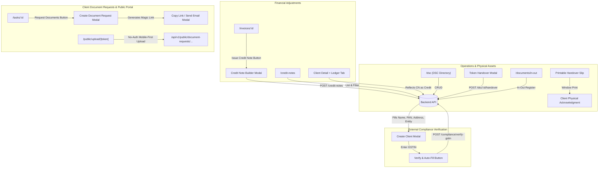

# Proactive SaaS — Phase 3: Frontend Micro-Phase Architecture Plan
## Web Application Implementation Specification (Phases F-71 to F-95)

> **Context:** Phase 3 Frontend Architecture for Digital Signature Certificates (DSC), Physical Token Custody, Credit Notes, Documents In-Out Register, Public Client Document Upload Portal, and GSTIN/PAN Auto-Fill.  
> **Complements:** [`Backend/docs/Phase_3_micro_phase.md`](file:///c:/Users/hp/Desktop/Proactive/Backend/docs/Phase_3_micro_phase.md) (Phases 71–95).  
> **Source Documents:** [`Requirement.md`](file:///c:/Users/hp/Desktop/Proactive/Backend/docs/Requirement.md) (Modules 6.11, 7.3, 9.1, 9.2, 10), [`MVPs.md`](file:///c:/Users/hp/Desktop/Proactive/Backend/docs/MVPs.md), [`readme.md`](file:///c:/Users/hp/Desktop/Proactive/readme.md).  
> **Target Application Root:** [`application/`](file:///c:/Users/hp/Desktop/Proactive/application) (Next.js 16 App Router · React 19 · TypeScript · Tailwind CSS v4 · RTK Query · Radix UI · Lucide Icons · Sonner).  
> **Target Status:** 0% Initialized → Production Ready Architecture Blueprint.

---

## 1. Architectural Overview & Design System

Phase 3 introduces critical physical asset management, credit note accounting, external verification auto-fill, and customer-facing public magic link portals into the Proactive web application.



---

## 2. Master Feature Matrix (Phases F-71 to F-95)

| Part | Phase | Title | Primary Route / Component | Core UI Deliverables |
|---|---|---|---|---|
| **Part 15** | **F-71** | DSC Management Directory | `/dsc` | Searchable directory table of client DSC tokens with status badges (In Office, With Client, Expired). |
| | **F-72** | Add / Edit DSC Modal | `/dsc` Modal | Modal with Certificate Class, Token Type, Serial No., Issue/Expiry date pickers, and storage shelf selector. |
| | **F-73** | DSC Token Handover & History Drawer | `/dsc` Drawer | Handover dialog (client vs staff) and slide-over timeline detailing movement history. |
| | **F-74** | Expiring DSC Dashboard Ribbon & Filters | `/dsc` & Dashboard | Quick-filter tabs: "Expiring in 7 Days" (Red), "15 Days" (Amber), "30 Days" (Yellow), and KPI badge. |
| | **F-75** | One-Click DSC Renewal Task Trigger | `/dsc` Row Action | Action button to convert an expiring DSC into an assigned internal Task with 1 click. |
| **Part 16** | **F-76** | Credit Note Master Directory | `/credit-notes` | Filterable data table of issued credit notes with original invoice links and credit statuses. |
| | **F-77** | "Issue Credit Note" Interactive Builder | `/invoices/[invoiceId]` | Invoice action modal with dynamic line items, return quantity, tax adjustments, and credit limits. |
| | **F-78** | Client Ledger Credit Note Stream | `/clients/[id]?tab=ledger` | Updates Ledger table to render Credit Note rows with purple pill badges and balance recalculation. |
| | **F-79** | Printable Credit Note View | `/credit-notes/[id]` | Professional printable/PDF-ready credit note layout with GSTIN breakdown and original invoice reference. |
| | **F-80** | Apply Unallocated Credit Modal | `/credit-notes/[id]` Action | Dialog allowing users to apply leftover credit balances against other unpaid client invoices. |
| **Part 17** | **F-81** | Documents In-Out Register Desk | `/documents/in-out` | Comprehensive register table with category toggle (Received / Given) and returnable badges. |
| | **F-82** | New In-Out Transaction Modal | `/documents/in-out` Modal | Form to record document receipt/handover with conditional "Return Date" picker for returnable items. |
| | **F-83** | Office Storage Location Master View | `/documents/in-out?view=storage`| Visual grid of office filing cabinets and drawers with item counters and search. |
| | **F-84** | Overdue Asset Warning Bar & Return Action | `/documents/in-out` Row Action | Amber warning banners for overdue returnable assets and 1-click "Record Return" modal. |
| | **F-85** | Printable Asset Handover Slip | `/documents/in-out/[id]/slip` | Clean, formal printable document handover slip with client signature and stamp sections. |
| **Part 18** | **F-86** | Create Document Request Modal | `/tasks` & `/clients` | Modal to create multi-file upload checklists with deadlines, mandatory toggles, and format restrictions. |
| | **F-87** | Magic Link Sharing & Email Dispatch Dialog | Dialog / Toast | Instant copy-to-clipboard magic link and 1-click email invitation sender. |
| | **F-88** | Public Mobile-First Client Upload Portal | `/public/upload/[token]` | Beautiful public page (no login required) with drag-and-drop file upload, size checks, and progress bars. |
| | **F-89** | Upload Success & Instant Task Feedback | `/public/upload/[token]` | Animated completion screen for clients and live toast notification for the assigned practice staff. |
| | **F-90** | Document Requests Management Hub | `/documents/requests` | Tracker showing progress ring (e.g. 75%), status, resend reminder button, and revoke link action. |
| **Part 19** | **F-91** | Compliance Verification Redux Slice | `lib/services/api.ts` | RTK Query endpoints for PAN and GSTIN validation with caching and error feedback. |
| | **F-92** | PAN Verification Input Component | `components/compliance/PanInput.tsx` | Auto-capitalizing PAN input with real-time regex feedback and "Verify" checkmark badge. |
| | **F-93** | GSTIN Verification Input Component | `components/compliance/GstinInput.tsx`| 15-character formatted GSTIN input with state detector and instant legal taxpayer status chip. |
| | **F-94** | 1-Click "Auto-Fill from GSTIN" in Client Modal | `/clients` Create Modal | Action button that fetches GSTIN details and instantly populates 7 client fields in under 500ms. |
| | **F-95** | Verified Compliance Badge & Audit Modal | `/clients/[id]` Header | "GSTIN Verified" and "PAN Verified" green shield badges with popover audit metadata. |

---

## 3. Implementation Roadmap & Route Additions

```
application/
├── app/
│   ├── (app)/
│   │   ├── dsc/
│   │   │   ├── page.tsx                           # DSC directory & expiry filters
│   │   │   └── [dscId]/page.tsx                   # DSC detail & movement audit trail
│   │   ├── credit-notes/
│   │   │   ├── page.tsx                           # Credit Notes master list
│   │   │   └── [cnId]/page.tsx                    # Printable Credit Note view
│   │   ├── documents/
│   │   │   ├── in-out/page.tsx                    # Documents In-Out Register
│   │   │   └── requests/page.tsx                  # Client Document Requests Hub
│   └── public/
│       └── upload/[token]/page.tsx                # Public Mobile-First Upload Portal
├── components/
│   ├── dsc/
│   │   ├── CreateDSCModal.tsx                     # Add/edit DSC dongle
│   │   ├── DSCHandoverModal.tsx                   # Handover custody logger
│   │   └── DSCExpiryRibbon.tsx                    # Expiry timeline badge bar
│   ├── credit-notes/
│   │   ├── IssueCreditNoteModal.tsx               # Invoice adjustment builder
│   │   └── ApplyCreditModal.tsx                   # Apply credit to unpaid invoices
│   ├── documents/
│   │   ├── CreateDocRequestModal.tsx              # Build document checklist
│   │   ├── InOutEntryModal.tsx                    # In-out register entry modal
│   │   └── PrintableHandoverSlip.tsx              # Physical asset custody slip
│   └── compliance/
│       ├── GstinAutoFillButton.tsx                # 1-click GSTIN auto-filler
│       └── VerifiedShieldBadge.tsx                # Green verified badge with popover
```
