# Proactive SaaS — Phase 4: Security Vault, Expenses, Quotations, BI & Integrations
## Backend Micro-Phase Architecture Plan (Phases 96–120)

> **Context:** Phase 4 Scope — Client Passwords Security Vault (AES-256-CBC), Client Reimbursable Expenses & Invoicing Bridge, Quotations / Estimates Engine & 1-Click Conversion, Enterprise Reporting & Streaming Excel Exports, Targeted Bulk Communications (BullMQ), Tally Accounting XML Sync, and Agency Master Settings.  
> **Source Documents:** [`Requirement.md` (Modules 6.9, 6.10, 7.4, 7.5, 10, 11, 12, 13)](file:///c:/Users/hp/Desktop/Proactive/Backend/docs/Requirement.md), [`MVPs.md` (Phase 4 Integrations & Roadmap)](file:///c:/Users/hp/Desktop/Proactive/Backend/docs/MVPs.md), [`readme.md`](file:///c:/Users/hp/Desktop/Proactive/readme.md).  
> **Stack:** Node.js · Express.js · TypeScript · MongoDB (Mongoose Multi-Doc Transactions) · BullMQ · Redis · Multer · Crypto (`aes-256-cbc`) · ExcelJS · xmlbuilder2.  
> **Target Status:** 0% Initialized → Production Ready Architecture Blueprint with Integration Testing Specifications.

---

## 1. Architectural Overview

Phase 4 elevates Proactive into a complete, enterprise-grade Practice Management Operating System. It delivers five critical systems:
1. **Security Vault:** Cryptographic two-way encrypted password storage for client tax portals (GST, Income Tax, MCA, TRACES) using `aes-256-cbc`, randomized initialization vectors (IV), and strict staff access audit trails.
2. **Reimbursable Expenses Engine:** Tracking out-of-pocket client outlays (challan fees, ROC stamp duty, court fees, travel) with receipt attachments, and seamless bridging into the invoice creation workspace (`isBilled: false` → `isBilled: true`).
3. **Pre-Sales Quotations & Conversion:** Professional proposal and estimate builder with itemized GST math and 1-click atomic conversion into active billing invoices.
4. **Business Intelligence & Streaming Reports:** Comprehensive cross-module analytics (operational bottlenecks, revenue breakdown, debtors aging 0–90+ days, staff time logs) backed by memory-safe streaming Excel (`.xlsx`) downloads via `exceljs`.
5. **Targeted Communications & Ecosystem Integrations:** BullMQ-powered asynchronous multi-channel dispatch (Email/WhatsApp/SMS), Tally XML accounting export synchronization, multi-entity firm billing, and atomic employee replacement reassignment.

```mermaid
graph TD
    subgraph Part 20: Security Vault
        Portals["Portal Master (GST, IT, MCA)"] --> Passwords["Client Passwords Collection"]
        Passwords -->|aes-256-cbc + IV| EncryptedAtRest[("MongoDB Encrypted Vault")]
        StaffUser["Staff Request"] -->|POST /passwords/:id/reveal| Decrypt["Two-Way Decrypt Engine"]
        Decrypt --> AuditLog["Security Access Audit Trail (IP, Timestamp, User)"]
    end

    subgraph Part 21: Client Expenses & Invoicing
        ReceiptUpload["Multer Receipt Upload"] --> ExpenseRecord["Client Expense (isBilled: false)"]
        InvoiceGen["Invoice Creation Engine"] -->|GET /billing/unbilled| ExpenseRecord
        InvoiceGen -->|ACID Transaction| BilledExpense["Mark isBilled: true & Link invoiceId"]
        InvoiceCancel["Cancel Invoice"] -->|Revert Transaction| UnbilledExpense["Revert isBilled: false"]
    end

    subgraph Part 22: Quotations & Pre-Sales CRM
        QuoteBuilder["Quotation Builder (Draft / Sent)"] --> ClientAccept["Client Accepts Quote"]
        ClientAccept -->|POST /quotations/:id/convert| ConvertEngine["Atomic Converter (MongoDB Transaction)"]
        ConvertEngine --> NewInvoice["Generated Invoice (Draft/Unpaid)"]
        ConvertEngine --> ConvertedQuote["Quotation Status: Converted"]
    end

    subgraph Part 23: BI & Streaming Excel Exports
        AggEngine["MongoDB Multi-Filter Aggregations ($facet, $lookup)"] --> DataStreams["Operational, Financial, HR Datasets"]
        DataStreams --> ExcelStream["ExcelJS Streaming Workbook Pipeline"]
        ExcelStream --> ClientDownload["Direct Browser File Download (Zero Server Memory Spikes)"]
    end

    subgraph Part 24: Communications & Ecosystem Integrations
        AudienceBuilder["Targeted Audience Query ($match, $lookup)"] --> BulkQueue["BullMQ Redis Dispatch Queue"]
        BulkQueue --> Worker["Background Worker (SMTP, WA Link, SMS)"]
        InvoicesReceipts[("Invoices & Receipts Collections")] --> TallyGen["xmlbuilder2 Tally XML Generator"]
        TallyGen --> TallyFile["Tally-Ready Accounting XML Import"]
        UserDeparture["Staff Departs Firm"] --> UserReplace["Atomic User Replacement (Tasks, Clients, Services Reassignment)"]
    end
```



---

## 2. Phase Breakdown & Feature Matrix (Phases 96–120)

| Part | Phase | Title | Primary Endpoints | Core Responsibility |
|---|---|---|---|---|
| **Part 20** | **96** | Portal Master & Password Vault Schema | N/A (Mongoose Models) | Portals catalog (`PortalMaster`) and tenant-scoped `ClientPassword` encrypted schema. |
| | **97** | AES-256-CBC Encryption & Decryption Engine | Pure Service Module | Cryptographic utility encrypting passwords with tenant secret & random 16-byte IV. |
| | **98** | Passwords Directory, Search & Filtering APIs | `POST /api/v1/passwords`<br>`GET /api/v1/passwords`<br>`PUT /api/v1/passwords/:id`<br>`DELETE /api/v1/passwords/:id` | Manage client credentials with masked passwords (`********`) and portal categorization. |
| | **99** | Password Reveal Endpoint & Statutory Audit Trail | `POST /api/v1/passwords/:id/reveal`<br>`GET /api/v1/passwords/audit-log` | Decrypts credentials on demand and logs user, timestamp, client, and client IP address. |
| | **100** | Password Bulk Import & Excel Ingestion Service | `POST /api/v1/passwords/bulk-import` | Multipart Excel spreadsheet ingestion with cryptographic batch encryption. |
| **Part 21** | **101** | Expense Model, Receipt Storage & Category Master | N/A (Mongoose Models & Multer) | Schema tracking client outlays with category, payment mode, and receipt attachment. |
| | **102** | Client Expense CRUD & Filterable Ledger APIs | `POST /api/v1/expenses`<br>`GET /api/v1/expenses`<br>`PUT /api/v1/expenses/:id`<br>`DELETE /api/v1/expenses/:id` | Filterable expenses ledger tracking unbilled vs billed costs and receipt previews. |
| | **103** | Unbilled Expenses Aggregation API for Billing | `GET /api/v1/billing/unbilled-expenses/:clientId` | Aggregates all `isBilled: false` client outlays ready to be incorporated into invoices. |
| | **104** | Atomic Invoice Ingestion & Auto-Marking | Service Transaction Hook | Links expenses into invoice line items and marks `isBilled: true` within MongoDB transaction. |
| | **105** | Invoice Cancellation Reversion & Expense Analytics | `POST /api/v1/invoices/:id/cancel` (Hook)<br>`GET /api/v1/analytics/expenses` | Reverts expenses to `isBilled: false` on invoice void; computes monthly practice outlay KPI. |
| **Part 22** | **106** | Quotation Schema, Itemized Tax & Sequence Generator | N/A (Mongoose Model & Service) | Multi-item pre-sales quote schema with SAC codes, GST calculation, and atomic `QT-XXXX`. |
| | **107** | Quotation CRUD & Directory Filtering APIs | `POST /api/v1/quotations`<br>`GET /api/v1/quotations`<br>`GET /api/v1/quotations/:id`<br>`PUT /api/v1/quotations/:id` | Full quote builder API with validity dates, client links, terms, and status filters. |
| | **108** | Quotation Status Lifecycle & Email Dispatch | `PATCH /api/v1/quotations/:id/status`<br>`POST /api/v1/quotations/:id/send` | Manage status transitions (`Draft` → `Sent` → `Accepted` / `Declined`) and dispatch PDF/HTML. |
| | **109** | 1-Click "Convert to Invoice" Atomic Engine | `POST /api/v1/quotations/:id/convert-to-invoice` | ACID transaction cloning quotation items into a formal `Invoice` and updating quote status. |
| | **110** | Quotation Printable Structure & Pipeline Analytics | `GET /api/v1/quotations/:id/print`<br>`GET /api/v1/analytics/quotation-pipeline` | Print-ready layout metadata and sales conversion funnel metrics (Win Rate %, Pipeline Value). |
| **Part 23** | **111** | Reporting Architecture & Dynamic Aggregation Pipeline | `GET /api/v1/reports/:reportType` | Reusable multi-filter query builder with date ranges, entity types, assignees, and tags. |
| | **112** | Operational & Task Reporting Endpoints | `GET /api/v1/reports/tasks`<br>`GET /api/v1/reports/services`<br>`GET /api/v1/reports/dsc-renewals` | Detailed operational reports: task completion bottlenecks, service volume, DSC timelines. |
| | **113** | Financial & Revenue Reporting Endpoints | `GET /api/v1/reports/invoices`<br>`GET /api/v1/reports/receipts`<br>`GET /api/v1/reports/gst-summary` | Financial audit data: taxable turnover, tax collected (CGST/SGST/IGST), receipts collection. |
| | **114** | Client Ledger & Debtors Aging Outstandings Report | `GET /api/v1/reports/debtors-aging` | Chronological aging buckets: 0–30, 31–60, 61–90, and 90+ days overdue balances. |
| | **115** | High-Performance Streaming Excel Export Engine | `GET /api/v1/reports/:reportType/export` | Memory-safe `exceljs` streaming file generator preventing Node.js buffer exhaustion. |
| **Part 24** | **116** | Notification Template Master & Audience Query Builder | `POST /api/v1/notifications/audience`<br>`GET /api/v1/notifications/templates` | Audience selector querying clients by unbilled tasks, overdue balances, tags, and groups. |
| | **117** | Asynchronous Bulk Communications Worker (BullMQ) | `POST /api/v1/notifications/send-bulk`<br>Queue Worker | Multi-tenant BullMQ worker dispatching bulk emails/SMS/WhatsApp links with rate-limiting. |
| | **118** | Tally XML Accounting Synchronization Service | `GET /api/v1/accounting/tally-export` | Generates Tally-compliant XML (`xmlbuilder2`) for Invoices and Receipts with ledger mapping. |
| | **119** | Master Taxonomies & Multi-Billing Entity Management | `POST /api/v1/masters/:type`<br>`PUT /api/v1/tenant-settings/billing-entities` | CRUD for firm masters (Tags, DocTypes, PayModes, Groups) and multi-entity firm profiles. |
| | **120** | Atomic User Replacement Utility | `POST /api/v1/users/replace-user` | MongoDB transaction reassigning all Tasks, Clients, and Services from departing staff to new user. |

---

## 3. Detailed Phase Specifications

---

### Part 20: Security Vault: Client Passwords & Two-Way AES-256-CBC Encryption (Phases 96–100)

#### Phase 96: Portal Master & Password Vault Schema
- **Goal:** Provide a dedicated data store for client credentials accessing statutory and government portals (GST, Income Tax, MCA, TRACES, PF/ESI, Customs).
- **Models:**
  - `Backend/src/models/PortalMaster.ts`: Catalog of supported portals (Name, URL, default username format, category).
  - `Backend/src/models/ClientPassword.ts`: Tenant-scoped credentials collection with encrypted secrets.
  ```typescript
  export interface IClientPassword extends Document {
    tenantId: mongoose.Types.ObjectId;
    clientId: mongoose.Types.ObjectId;
    portalId?: mongoose.Types.ObjectId;
    portalName: string; // e.g. "GST Portal", "Income Tax e-Filing", "MCA / ROC"
    portalUrl?: string; // e.g. "https://services.gst.gov.in"
    username: string; // Plaintext username / ID (e.g. GSTIN or PAN)
    encryptedPassword: string; // Hex-encoded ciphertext
    iv: string; // 16-byte Hex-encoded Initialization Vector
    authTag?: string; // If using GCM mode or HMAC verification
    notes?: string;
    lastVerifiedDate?: Date;
    createdBy: mongoose.Types.ObjectId;
    updatedBy: mongoose.Types.ObjectId;
    createdAt: Date;
    updatedAt: Date;
  }
  ```
- **Indexes:**
  - `{ tenantId: 1, clientId: 1 }`
  - `{ tenantId: 1, portalName: 1 }`
- **Plugin:** Attach `tenantPlugin`.

#### Phase 97: AES-256-CBC Encryption & Decryption Engine
- **Goal:** Build an isolated cryptographic utility in `Backend/src/utils/crypto-vault.ts` using Node.js native `crypto`.
- **Implementation Rules:**
  - Algorithm: `aes-256-cbc`.
  - Secret Key: Derived from `process.env.VAULT_ENCRYPTION_KEY` (must be 32 bytes / 256 bits). If key is missing, throws `ApiError(500, 'Vault encryption key is unconfigured')`.
  - Initialization Vector: Cryptographically randomized 16 bytes (`crypto.randomBytes(16)`) generated fresh for *every single password write*.
  - Helper functions:
    ```typescript
    export function encryptPassword(plainText: string): { encryptedPassword: string; iv: string } {
      const iv = crypto.randomBytes(16);
      const cipher = crypto.createCipheriv('aes-256-cbc', Buffer.from(process.env.VAULT_ENCRYPTION_KEY!, 'hex'), iv);
      let encrypted = cipher.update(plainText, 'utf8', 'hex');
      encrypted += cipher.final('hex');
      return { encryptedPassword: encrypted, iv: iv.toString('hex') };
    }

    export function decryptPassword(encryptedHex: string, ivHex: string): string {
      const iv = Buffer.from(ivHex, 'hex');
      const decipher = crypto.createDecipheriv('aes-256-cbc', Buffer.from(process.env.VAULT_ENCRYPTION_KEY!, 'hex'), iv);
      let decrypted = decipher.update(encryptedHex, 'hex', 'utf8');
      decrypted += decipher.final('utf8');
      return decrypted;
    }
    ```
- **Test:** Unit test verifying that encrypting `"SecretTax@2026"` produces different ciphertexts on separate invocations (due to unique IVs), and both decrypt cleanly to `"SecretTax@2026"`.

#### Phase 98: Passwords Directory, Search & Filtering APIs
- **Goal:** Expose RESTful endpoints allowing staff to manage client credentials while ensuring passwords remain masked (`"••••••••"`) in standard responses.
- **Endpoints:**
  - `POST /api/v1/passwords`: Encrypts incoming `password` payload via Phase 97 and saves document. Never echoes raw password back.
  - `GET /api/v1/passwords`: Filterable by `clientId`, `portalName`, or `search`. Projection explicitly excludes `encryptedPassword` and `iv` by default for high security; returns `isConfigured: true`.
  - `GET /api/v1/passwords/:id`: Returns single credential metadata (still masked).
  - `PUT /api/v1/passwords/:id`: Re-encrypts password if updated; updates username/notes/portal.
  - `DELETE /api/v1/passwords/:id`: RBAC-protected credential deletion.
- **RBAC:** Requires `passwords.view`, `passwords.create`, `passwords.edit`, `passwords.delete`.

#### Phase 99: Password Reveal Endpoint & Statutory Audit Trail
- **Goal:** Secure on-demand password decryption endpoint that strictly logs every single access attempt for auditability.
- **Model:** `Backend/src/models/PasswordAuditLog.ts`
  ```typescript
  export interface IPasswordAuditLog extends Document {
    tenantId: mongoose.Types.ObjectId;
    passwordId: mongoose.Types.ObjectId;
    clientId: mongoose.Types.ObjectId;
    portalName: string;
    accessedByUserId: mongoose.Types.ObjectId;
    accessedAt: Date;
    ipAddress?: string;
    userAgent?: string;
    purpose?: string;
  }
  ```
- **Endpoint:**
  - `POST /api/v1/passwords/:id/reveal`:
    - Validates user role permission `passwords.reveal`.
    - Decrypts password using Phase 97 utility.
    - Creates `PasswordAuditLog` document with `req.ip` and `req.headers['user-agent']`.
    - Returns `{ password: plainTextPassword }`.
  - `GET /api/v1/passwords/audit-log`: Paginated audit log showing who revealed what password, when, and from which IP address.

#### Phase 100: Password Bulk Import & Excel Ingestion Service
- **Goal:** Allow practice managers to onboard existing client portals via spreadsheet upload without storing unencrypted files on disk.
- **Endpoint:**
  - `POST /api/v1/passwords/bulk-import`:
    - Accepts multipart `.xlsx` file using Multer memory storage (`req.file.buffer`).
    - Parses columns: `Client File No. / Name`, `Portal Name`, `Username`, `Password`, `Notes`.
    - Matches client by File No. or Name within current tenant.
    - Encrypts each password row individually.
    - Uses `ClientPassword.bulkWrite()` with `upsert: true` on `{ tenantId, clientId, portalName }`.
    - Returns summary: `{ importedCount, updatedCount, skippedErrors: [] }`.

---

### Part 21: Client Reimbursable Expenses & Invoicing Bridge (Phases 101–105)

#### Phase 101: Expense Model, Receipt Storage & Category Master
- **Goal:** Provide financial tracking for out-of-pocket costs paid by the firm on behalf of the client (statutory government fees, ROC forms, court stamps, travel).
- **Models:**
  - `Backend/src/models/ExpenseCategory.ts`: Tenant-scoped lookup (e.g. "Challan / Tax Paid", "Government Stamping", "Legal Fees", "Travel & Conveyance", "Stationery").
  - `Backend/src/models/Expense.ts`:
  ```typescript
  export interface IExpense extends Document {
    tenantId: mongoose.Types.ObjectId;
    clientId: mongoose.Types.ObjectId;
    taskId?: mongoose.Types.ObjectId; // Optional: linked task
    expenseNo: string; // e.g. "EXP-2026-001"
    date: Date;
    categoryId: mongoose.Types.ObjectId;
    categoryName: string;
    amount: number;
    paymentMode: 'Bank Transfer' | 'Cash' | 'UPI' | 'Credit Card' | 'Cheque';
    paidFromAccount?: string;
    notes?: string;
    receiptFileUrl?: string; // Physical receipt scan / PDF voucher
    receiptFileName?: string;
    isBilled: boolean; // Default false
    invoiceId?: mongoose.Types.ObjectId; // Populated when billed
    billedAt?: Date;
    createdBy: mongoose.Types.ObjectId;
    createdAt: Date;
    updatedAt: Date;
  }
  ```
- **Indexes:**
  - `{ tenantId: 1, clientId: 1, isBilled: 1 }`
  - `{ tenantId: 1, date: -1 }`
  - `{ tenantId: 1, invoiceId: 1 }`
- **Multer:** Saves receipt vouchers under `/public/uploads/expenses/:tenantId/:clientId/` with 5MB file size limit (PDF, PNG, JPG).

#### Phase 102: Client Expense CRUD & Filterable Ledger APIs
- **Goal:** Full management endpoints for tracking reimbursable client costs.
- **Endpoints:**
  - `POST /api/v1/expenses`: Uploads receipt voucher (multipart), auto-generates sequential `EXP-XXXX` number, and creates record (`isBilled: false`).
  - `GET /api/v1/expenses`: Paginated listing with multi-filter query: `clientId`, `isBilled` (`true` / `false` / `all`), `categoryId`, `startDate`, `endDate`, and `search`.
  - `GET /api/v1/expenses/:id`: Fetches expense record with populated client, task, and uploader.
  - `PUT /api/v1/expenses/:id`: Updates unbilled expense. If `isBilled: true`, blocks mutation with `ApiError(400, 'Cannot edit an expense that has already been billed')`.
  - `DELETE /api/v1/expenses/:id`: Deletes unbilled expense and unlinks physical receipt file. If billed, blocks deletion.

#### Phase 103: Unbilled Expenses Aggregation API for Billing
- **Goal:** Dedicated endpoint called by the invoice builder when an accountant prepares a client invoice.
- **Endpoint:**
  - `GET /api/v1/billing/unbilled-expenses/:clientId`:
    - Queries all expenses where `clientId` matches, `tenantId` matches, and `isBilled === false`.
    - Returns array of reimbursable line items with formatted particulars: `"[Expense Category]: Notes - Date"`.
    - Computes `totalUnbilledExpensesAmount`.

#### Phase 104: Atomic Invoice Ingestion & Auto-Marking
- **Goal:** Connect the billing engine with expenses inside a MongoDB ACID transaction.
- **Business Logic Hook (`invoice.service.ts`):**
  - When creating an invoice with expense items (`referenceType: 'Expense'`, `referenceId: expenseId`):
    ```typescript
    await Expense.updateMany(
      {
        _id: { $in: expenseIds },
        tenantId,
        clientId,
        isBilled: false
      },
      {
        $set: {
          isBilled: true,
          invoiceId: savedInvoice._id,
          billedAt: new Date()
        }
      },
      { session }
    );
    ```
  - If any expense in `expenseIds` is already marked `isBilled: true`, the transaction aborts with `ApiError(409, 'One or more selected expenses have already been billed on another invoice')`.

#### Phase 105: Invoice Cancellation Reversion & Expense Analytics
- **Goal:** Ensure financial consistency when invoices are voided or cancelled, and provide practice outlay metrics.
- **Cancellation Hook:**
  - When an invoice is cancelled (`POST /api/v1/invoices/:id/cancel`):
    - Reverts all linked expenses:
      ```typescript
      await Expense.updateMany(
        { invoiceId: invoice._id, tenantId },
        {
          $set: {
            isBilled: false,
            invoiceId: null,
            billedAt: null
          }
        },
        { session }
      );
      ```
- **Analytics Endpoint:**
  - `GET /api/v1/analytics/expenses`: Aggregates total monthly outlays, reimbursable vs non-reimbursable totals, recovery rate `%` (`billedAmount / totalAmount`), and pending unrecovered balance.

---

### Part 22: Quotations & Estimates Management (Pre-Sales CRM) (Phases 106–110)

#### Phase 106: Quotation Schema, Itemized Tax & Sequence Generator
- **Goal:** Define the pre-sales proposal data model with Indian taxation (SAC, CGST, SGST, IGST) and atomic numbering sequence.
- **Model:** `Backend/src/models/Quotation.ts`
  ```typescript
  export interface IQuotationItem {
    serviceId?: mongoose.Types.ObjectId;
    description: string;
    sacCode?: string;
    rate: number;
    quantity: number;
    amount: number;
    gstPercentage: number;
    cgst: number;
    sgst: number;
    igst: number;
    total: number;
  }

  export interface IQuotation extends Document {
    tenantId: mongoose.Types.ObjectId;
    clientId: mongoose.Types.ObjectId;
    billingEntityId: mongoose.Types.ObjectId;
    quotationNo: string; // e.g. "QT-2026-001"
    date: Date;
    validUntil: Date;
    items: IQuotationItem[];
    totals: {
      subtotal: number;
      taxTotal: number;
      cgstTotal: number;
      sgstTotal: number;
      igstTotal: number;
      roundOff: number;
      grandTotal: number;
    };
    termsAndConditions?: string;
    notes?: string;
    status: 'Draft' | 'Sent' | 'Accepted' | 'Declined' | 'Converted';
    convertedInvoiceId?: mongoose.Types.ObjectId;
    convertedAt?: Date;
    createdBy: mongoose.Types.ObjectId;
    createdAt: Date;
    updatedAt: Date;
  }
  ```
- **Sequence Generator:** Atomic sequence generator `QT-YYYY-XXXX` per tenant using Mongoose `Sequence` counters.
- **Isolation:** Quotations are strictly pre-sales and have ZERO impact on ledger balances or revenue until converted.

#### Phase 107: Quotation CRUD & Directory Filtering APIs
- **Goal:** Provide complete RESTful endpoints to create, list, inspect, and update quotation proposals.
- **Endpoints:**
  - `POST /api/v1/quotations`: Validates client, items, tax percentages, calculates subtotals and grand totals, and creates quotation in `Draft` status.
  - `GET /api/v1/quotations`: Paginated list filterable by `clientId`, `status`, `startDate`, `endDate`, and `search` (quote number, client name).
  - `GET /api/v1/quotations/:id`: Returns full quotation with populated client details, billing entity branding, and item breakdown.
  - `PUT /api/v1/quotations/:id`: Updates quotation content. If status is `Converted`, blocks updates with `ApiError(400, 'Cannot edit a quotation that has already been converted to an invoice')`.
  - `DELETE /api/v1/quotations/:id`: Soft-deletes draft/declined quotation.

#### Phase 108: Quotation Status Lifecycle & Email Dispatch
- **Goal:** Track quotation lifecycle transitions and send proposal summaries directly to prospective or existing clients.
- **Endpoints:**
  - `PATCH /api/v1/quotations/:id/status`: Transitions status: `Draft` → `Sent` → `Accepted` or `Declined`.
  - `POST /api/v1/quotations/:id/send`:
    - Dispatches an email via `nodemailer` with formal HTML quotation breakdown and PDF-ready link.
    - Automatically transitions status from `Draft` to `Sent`.
    - Logs dispatch timestamp.

#### Phase 109: 1-Click "Convert to Invoice" Atomic Engine
- **Goal:** Eliminate duplicate data entry by converting an accepted quotation into an active invoice in a single click using MongoDB transactions.
- **Endpoint:**
  - `POST /api/v1/quotations/:id/convert-to-invoice`:
    - Starts MongoDB Session and Transaction.
    - Validates quotation exists and is not already `Converted`.
    - Fetches next atomic Invoice sequence number (`INV-XXXX`).
    - Creates `Invoice` document:
      - Maps `quotation.items` directly to `invoice.items` (`referenceType: 'Manual'`).
      - Transfers SAC codes, rates, GST breakdowns, and totals.
      - Sets status to `Unpaid` or `Draft`.
    - Updates quotation:
      - Sets `status: 'Converted'`.
      - Links `convertedInvoiceId: newInvoice._id`.
      - Sets `convertedAt: new Date()`.
    - Commits transaction.
    - Returns newly created `Invoice` document.

#### Phase 110: Quotation Printable Structure & Pipeline Analytics
- **Goal:** Provide clean printable structure for browser print / PDF export and pre-sales pipeline metrics.
- **Endpoints:**
  - `GET /api/v1/quotations/:id/print`: Formats data specifically for print views (includes tenant logo, firm GSTIN, banking details, terms & conditions, client address).
  - `GET /api/v1/analytics/quotation-pipeline`: Computes proposal conversion funnel:
    - Total Quotes Issued, Total Value Proposed (₹).
    - Accepted Quotes Value vs Declined Quotes Value.
    - Conversion Rate `%` (`convertedCount / totalSentCount * 100`).

---

### Part 23: Business Intelligence, Reporting & Streaming Excel Exports (Phases 111–115)

#### Phase 111: Reporting Architecture & Dynamic Aggregation Pipeline
- **Goal:** Establish a modular aggregation framework in `Backend/src/services/report.service.ts` that dynamically parses query filters (date ranges, assignees, client groups, tags, statuses) into MongoDB aggregation pipelines without code duplication.
- **Features:**
  - Standardized pagination parser (`page`, `limit`).
  - Tenant isolation filter injected into the very first `$match` stage of every report pipeline.
  - Automatic `$facet` execution for total count and paginated data slice.

#### Phase 112: Operational & Task Reporting Endpoints
- **Goal:** Provide macro-level practice operational intelligence.
- **Endpoints:**
  - `GET /api/v1/reports/tasks`: Aggregates tasks across the practice. Filterable by `serviceId`, `assignedUserId`, `status`, `priority`, `dueDateRange`. Shows total logged time vs estimated time, overdue status, and completion velocity.
  - `GET /api/v1/reports/services`: Aggregates active service subscriptions across the client base, showing client counts per service, recurring frequencies, and revenue yield per service.
  - `GET /api/v1/reports/dsc-renewals`: Generates timeline report of all client DSC tokens expiring in next 30, 60, 90, 180 days with holder custody status.

#### Phase 113: Financial & Revenue Reporting Endpoints
- **Goal:** Practice revenue, tax liability, and collection reporting for accountants and firm partners.
- **Endpoints:**
  - `GET /api/v1/reports/invoices`: Deep financial breakdown: Total Invoiced (Gross), Subtotal (Taxable Value), Total Discounts, Total Tax (CGST, SGST, IGST), Amount Paid, and Balance Due. Supports filtering by Billing Entity and Payment Status.
  - `GET /api/v1/reports/receipts`: Cash flow report tracking collections by payment mode (Cash, Bank, UPI, Cheque), TDS deducted by clients, and auto-settlement distributions.
  - `GET /api/v1/reports/gst-summary`: GSTR-1 preparation report itemizing B2B invoices with client GSTIN, SAC code, taxable value, and tax breakdown.

#### Phase 114: Client Ledger & Debtors Aging Outstandings Report
- **Goal:** Solve agency cash flow delays by categorizing unpaid balances into standard financial aging buckets.
- **Endpoint:**
  - `GET /api/v1/reports/debtors-aging`:
    - Aggregates all unpaid and partially paid invoices.
    - Computes days overdue: `(Date.now() - invoice.dueDate) / (1000 * 60 * 60 * 24)`.
    - Categorizes balances into 4 aging buckets:
      - `Current (0–30 Days)`
      - `Overdue (31–60 Days)`
      - `Critical (61–90 Days)`
      - `Delinquent (90+ Days)`
    - Groups by `clientId`, calculating total exposure per client and firm-wide totals.

#### Phase 115: High-Performance Streaming Excel Export Engine (`exceljs`)
- **Goal:** Eliminate server memory spikes when exporting reports containing thousands of rows by streaming the Excel workbook directly to the HTTP response stream.
- **Technology:** `exceljs` (`WorkbookWriter`).
- **Endpoint:**
  - `GET /api/v1/reports/:reportType/export`:
    - Sets HTTP response headers:
      ```typescript
      res.setHeader('Content-Type', 'application/vnd.openxmlformats-officedocument.spreadsheetml.sheet');
      res.setHeader('Content-Disposition', `attachment; filename="${reportType}_export_${Date.now()}.xlsx"`);
      ```
    - Initializes streaming workbook:
      ```typescript
      const workbook = new ExcelJS.stream.xlsx.WorkbookWriter({ stream: res });
      const worksheet = workbook.addWorksheet('Report');
      ```
    - Writes header row with styling (Bold, fill color `#1e293b`, font color `#ffffff`).
    - Uses Mongoose `.cursor()` to iterate through documents one-by-one, writing rows directly to the stream without loading the full dataset into V8 RAM.
    - Commits worksheet and workbook upon completion.

---

### Part 24: Targeted Communications, Tally XML Export & Agency Settings (Phases 116–120)

#### Phase 116: Notification Template Master & Audience Query Builder
- **Goal:** Provide automated message templates with dynamic placeholders and an audience segmenter to query clients based on operational criteria.
- **Model:** `Backend/src/models/NotificationTemplate.ts` (Title, Channel: Email/SMS/WhatsApp, Subject, Body with variables like `{{clientName}}`, `{{outstandingBalance}}`, `{{taskName}}`, `{{dueDate}}`).
- **Endpoint:**
  - `POST /api/v1/notifications/audience`:
    - Accepts segment query filters:
      - `hasUnpaidInvoices`: boolean
      - `minOutstandingAmount`: number
      - `subscribedServiceId`: string
      - `clientTags`: string[]
      - `clientGroups`: string[]
      - `hasActiveTasks`: boolean
    - Executes MongoDB aggregation returning matching client recipients with phone numbers, emails, and interpolated variables.

#### Phase 117: Asynchronous Bulk Communications Worker (BullMQ + Redis)
- **Goal:** Prevent HTTP thread blocking when dispatching communications to hundreds of clients simultaneously.
- **Queue & Worker:** `Backend/src/queues/bulk-notification.queue.ts` & `Backend/src/queues/bulk-notification.worker.ts`.
- **Endpoint:**
  - `POST /api/v1/notifications/send-bulk`:
    - Enqueues job to BullMQ with payload: `{ templateId, recipientIds, channel, customMessage }`.
    - Responds immediately with `202 Accepted` (`{ jobId, status: 'Queued', totalRecipients }`).
- **Worker Logic:**
  - Pulls recipient batch from Redis queue.
  - Applies rate limiting (e.g. max 10 emails/sec to prevent SMTP provider throttling).
  - Interpolates dynamic variables for each client.
  - Dispatches email via Nodemailer or formats WhatsApp Web direct intent URLs.
  - Records delivery status in `NotificationLog`.

#### Phase 118: Tally XML Accounting Synchronization Service (`xmlbuilder2`)
- **Goal:** Export finalized financial transactions (Invoices & Receipts) in standard Tally XML format for seamless import into TallyPrime / Tally.ERP 9.
- **Endpoint:**
  - `GET /api/v1/accounting/tally-export`:
    - Query parameters: `startDate`, `endDate`, `type` (`sales` / `receipts` / `all`), `billingEntityId`.
    - Generates Tally standard envelope:
      ```xml
      <ENVELOPE>
        <HEADER>
          <TALLYREQUEST>Import Data</TALLYREQUEST>
        </HEADER>
        <BODY>
          <IMPORTDATA>
            <REQUESTDATA>
              <TALLYMESSAGE xmlns:UDF="TallyUDF">
                <!-- VOUCHERS -->
              </TALLYMESSAGE>
            </REQUESTDATA>
          </IMPORTDATA>
        </BODY>
      </ENVELOPE>
      ```
    - Maps:
      - Invoices → `<VOUCHER VCHTYPE="Sales" ACTION="Create">` with Ledger entries for `Sundry Debtors`, `Professional Fees / Sales`, `Output CGST`, `Output SGST`, `Output IGST`.
      - Receipts → `<VOUCHER VCHTYPE="Receipt" ACTION="Create">` with Ledger entries for `Bank / Cash` and `Sundry Debtors`.
    - Returns XML file with headers `Content-Type: application/xml`.

#### Phase 119: Master Taxonomies & Multi-Billing Entity Management
- **Goal:** Centralized configuration endpoints for firm taxonomies and multi-company billing profiles.
- **Endpoints:**
  - `POST /api/v1/masters/:type`: Generic CRUD for lightweight taxonomies (`tags`, `client-groups`, `expense-categories`, `document-types`, `payment-modes`).
  - `GET /api/v1/masters/bootstrap`: Unified bootstrap payload fetching all firm dropdown lookup tables in a single cached call to prevent UI network waterfalls.
  - `GET /api/v1/tenant-settings/billing-entities`: Manage multi-entity legal profiles:
    - Legal Entity Name, Trade Name.
    - Registered Office Address, State, Pincode.
    - GSTIN, PAN, CIN.
    - Bank Account Details & IFSC.
    - UPI ID (used for dynamic QR code on invoice PDFs).
    - Invoice Number Prefix (e.g. `INV/26-27/`).
    - Logo URL & Authorized Signatory Image.

#### Phase 120: Atomic User Replacement Utility (Staff Handover)
- **Goal:** Solve the common agency bottleneck when an employee resigns or departs the firm by reassigning all their responsibilities in a single atomic database transaction.
- **Endpoint:**
  - `POST /api/v1/users/replace-user`:
    - Request payload: `{ departingUserId: string, replacementUserId: string, reassignTasks: boolean, reassignClients: boolean, reassignServices: boolean }`.
    - Starts MongoDB Session and ACID Transaction:
      - **Tasks:** Updates all incomplete tasks (`status !== 'Completed' && status !== 'Cancelled'`) where `assignedUserId === departingUserId` to `replacementUserId`. Appends audit entry to `TaskHistory`.
      - **Clients:** Replaces `departingUserId` in `Client.assignedUsers` array with `replacementUserId`.
      - **Services:** Replaces `departingUserId` in `Client.subscribedServices.customUsers` overrides with `replacementUserId`.
      - **Deactivate:** Automatically toggles `departingUser.isActive = false`.
    - Commits transaction.
    - Returns `{ tasksReassignedCount, clientsReassignedCount, servicesReassignedCount, userDeactivated: true }`.

---

## 4. Verification & Testing Strategy

Each micro-phase in Phase 4 includes rigorous testing requirements:
1. **Security Vault Tests:**
   - Password encryption test verifying unique IVs per save.
   - Reveal endpoint test asserting decrypted value matches original plaintext.
   - Audit log test asserting `PasswordAuditLog` records caller ID and IP.
2. **Reimbursable Expenses Tests:**
   - Create expense test with receipt attachment.
   - ACID transaction test: Link expense to invoice, assert `isBilled: true` and `invoiceId` populated.
   - Cancel invoice test: Assert expense reverts to `isBilled: false` and `invoiceId: null`.
3. **Quotations Conversion Tests:**
   - Create quotation test with itemized GST calculations.
   - 1-Click convert test: Assert new invoice created with identical line items and quotation status set to `Converted`.
4. **BI & Streaming Export Tests:**
   - Debtors aging test: Assert overdue invoices categorized into correct 0–30, 31–60, 61–90, 90+ buckets.
   - Streaming Excel export test: Assert HTTP response streams `application/vnd.openxmlformats-officedocument.spreadsheetml.sheet` with status 200.
5. **Integrations Tests:**
   - Tally XML test: Assert output XML conforms to Tally schema with balanced debit/credit voucher entries.
   - User replacement test: Assert departing user's tasks and clients transferred atomically and user deactivated.
