# Proactive SaaS — Phase 4: Frontend Micro-Phase Architecture Plan
## Web Application Implementation Specification (Phases F-96 to F-120)

> **Context:** Phase 4 Frontend Architecture for Security Vault (Client Passwords), Reimbursable Client Expenses, Pre-Sales Quotations & 1-Click Invoicing, Enterprise Reporting & Excel Streaming Exports, Targeted Bulk Communications, Tally Accounting Export, and Agency Masters.  
> **Complements:** [`Backend/docs/Phase_4_micro_phase.md`](file:///c:/Users/hp/Desktop/Proactive/Backend/docs/Phase_4_micro_phase.md) (Phases 96–120).  
> **Source Documents:** [`Requirement.md`](file:///c:/Users/hp/Desktop/Proactive/Backend/docs/Requirement.md) (Modules 6.9, 6.10, 7.4, 7.5, 10, 11, 12, 13), [`MVPs.md`](file:///c:/Users/hp/Desktop/Proactive/Backend/docs/MVPs.md), [`readme.md`](file:///c:/Users/hp/Desktop/Proactive/readme.md).  
> **Target Application Root:** [`application/`](file:///c:/Users/hp/Desktop/Proactive/application) (Next.js 16 App Router · React 19 · TypeScript · Tailwind CSS v4 · RTK Query · Radix UI · Lucide Icons · Sonner).  
> **Target Status:** 0% Initialized → Production Ready Architecture Blueprint.

---

## 1. Architectural Overview & Design System

Phase 4 completes the core practice management user experience across five UI domains:
1. **Security Vault:** Interactive password management on client profiles with masked values, eye-toggle decryption, copy-to-clipboard, portal icons, and bulk Excel import.
2. **Reimbursable Expenses:** Client expense ledger with receipt preview modal and an intuitive "Add Unbilled Expenses" checklist picker embedded directly inside the invoice generation workspace.
3. **Quotations & Estimates CRM:** Pre-sales proposal builder with itemized pricing, tax computation, formal printable proposal layouts, and a 1-click "Convert to Invoice" action.
4. **Reports & BI Dashboard:** Dedicated `/reports` hub with a unified, filter-heavy `<ReportLayout />` component, debtors aging bucket visualization (0–90+ days), and direct streaming Excel download buttons.
5. **Targeted Dispatch & Practice Settings:** Multi-tab communications center (`/notifications/send`) with query filters, Tally XML export download modal, and a user handover replacement wizard.

```mermaid
graph TD
    subgraph Security Vault
        ClientPage["/clients/[id] (Passwords Tab)"] --> CredentialTable["Masked Credentials List (••••••••)"]
        CredentialTable -->|Click Eye Icon| RevealDialog["Decrypted Password Modal + Copy Button"]
        CredentialTable -->|Add Credential| AddCredModal["Portal Selector & Encrypted Save Modal"]
    end

    subgraph Client Expenses & Invoicing
        ExpensesTab["Client Detail > Expenses Tab"] --> LogExpense["Add Expense Modal (Multer Receipt Upload)"]
        CreateInvoice["/invoices/new (Invoice Builder)"] --> UnbilledModal["Fetch Unbilled Expenses Accordion"]
        UnbilledModal -->|Checkbox Selection| AddedLineItems["Auto-Added as Invoice Line Items"]
    end

    subgraph Quotations & Pre-Sales CRM
        QuotesHub["/quotations (Master Directory)"] --> NewQuote["Create Quotation Interactive Builder"]
        QuotesHub --> QuoteDetail["/quotations/[id] (Printable Proposal Layout)"]
        QuoteDetail -->|1-Click Convert| InvoiceCreated["Redirects to Auto-Generated Invoice"]
    end

    subgraph Reports & BI
        ReportsHub["/reports (Navigation Sidebar)"] --> MasterFilter["Dynamic Filter Bar (Dates, Users, Statuses)"]
        MasterFilter --> ReportGrid["Data Table with Dynamic Columns"]
        ReportGrid -->|Export Button| ExcelStream["Direct .xlsx File Download Stream"]
    end

    subgraph Communications & Handover
        NotifHub["/notifications/send"] --> AudienceFilter["Query Builder: Unpaid Invoices, Active Tasks"]
        AudienceFilter --> DispatchModal["Template Selector & Send Preview"]
        SettingsPage["/settings/masters"] --> UserReplaceModal["User Replacement Wizard (Atomic Handover)"]
    end
```



---

## 2. Master Feature Matrix (Phases F-96 to F-120)

| Part | Phase | Title | Primary Route / Component | Core UI Deliverables |
|---|---|---|---|---|
| **Part 20** | **F-96** | Client Passwords Tab Interface | `/clients/[id]?tab=passwords` | Masked credential list with portal badges, usernames, and last-updated timestamps. |
| | **F-97** | Add & Edit Credential Modal | `/clients/[id]` Modal | Modal with portal master dropdown, custom portal input, username, and password fields. |
| | **F-98** | Secure Password Reveal & Copy Dialog | `/clients/[id]` Action | Eye-icon action triggering decrypted reveal with 1-click copy-to-clipboard button. |
| | **F-99** | Passwords Security Audit Drawer | `/clients/[id]` Drawer | Slide-over drawer listing chronological staff access logs (who viewed password & when). |
| | **F-100** | Password Bulk Excel Import Modal | `/clients/[id]` Modal | File uploader accepting Excel sheets with column mapping and batch ingestion feedback. |
| **Part 21** | **F-101** | Client Expenses Tab Interface | `/clients/[id]?tab=expenses` | Expense ledger table displaying category, amount, payment mode, receipt, and billing status. |
| | **F-102** | Add Client Expense Modal | `/clients/[id]` Modal | Form with category master selector, date picker, amount, notes, and file dropzone. |
| | **F-103** | Receipt Voucher Preview Dialog | `/clients/[id]` Action | High-fidelity image and PDF viewer dialog for physical receipt vouchers. |
| | **F-104** | "Add Unbilled Expenses" in Invoice Modal | `/invoices/new` Modal | Collapsible drawer in invoice builder displaying unbilled client outlays with auto-add check. |
| | **F-105** | Practice Outlays KPI & Expense Summary | `/expenses` & `/dashboard` | Mini-analytics bar showing total practice outlays, billed recoveries, and unbilled exposure. |
| **Part 22** | **F-106** | Quotations Master Directory | `/quotations` | Data table of pre-sales estimates with client, status badges (Draft, Sent, Accepted), and total. |
| | **F-107** | Interactive Quotation Builder Modal | `/quotations` Modal | Dynamic multi-item proposal builder with service selector, quantity, rate, and GST tax math. |
| | **F-108** | Printable Quotation Proposal View | `/quotations/[id]` | Formal PDF-ready quotation page with firm branding, itemized SAC breakdown, and terms. |
| | **F-109** | 1-Click "Convert to Invoice" Action | `/quotations/[id]` Action | Action button that creates a finalized invoice from quotation items and routes user to it. |
| | **F-110** | Pre-Sales Conversion Pipeline Widget | `/dashboard` & `/quotations` | Visual funnel showing Quotations Sent, Win Rate %, Total Proposed Value, and Converted Value. |
| **Part 23** | **F-111** | Dynamic Reports Navigation & Shell | `/reports` | Master reporting layout with left sidebar category switch (Operational, Financial, HR). |
| | **F-112** | Multi-Filter Query Bar Component | `components/reports/FilterBar.tsx` | Reusable toolbar with date presets (This Month, Last Quarter), user, service, and tag selectors. |
| | **F-113** | Operational & Task Report Tables | `/reports/tasks` & `/reports/dsc` | Aggregated tables showing overdue tasks, bottleneck analysis, and DSC renewal timelines. |
| | **F-114** | Debtors Aging Matrix & Chart View | `/reports/debtors-aging` | Visual colored aging cards (0–30, 31–60, 61–90, 90+ days) and client breakdown table. |
| | **F-115** | 1-Click Streaming Excel Download Button | `components/reports/ExportButton.tsx`| Action button initiating direct binary `.xlsx` stream download with loading spinner. |
| **Part 24** | **F-116** | Targeted Dispatch Hub & Audience Query | `/notifications/send` | Audience filter builder: clients with unpaid invoices, active tasks, or specific tags. |
| | **F-117** | Message Composition & Template Dialog | `/notifications/send` Modal | Template selector with dynamic preview (`{{clientName}}`, `{{outstandingAmount}}`) and bulk send. |
| | **F-118** | Tally XML Accounting Export Modal | `/settings/tally-export` | Date range selector generating downloadable Tally XML file for Invoices and Receipts. |
| | **F-119** | Master Taxonomies & Entity Settings | `/settings/masters` | Clean tabbed management interface for Tags, Doc Types, Pay Modes, and Billing Entities. |
| | **F-120** | Staff Replacement & Handover Wizard | `/settings/users` Wizard | Multi-step modal transferring tasks, clients, and services from departing staff to new user. |

---

## 3. Implementation Roadmap & Route Additions

```
application/
├── app/
│   ├── (app)/
│   │   ├── quotations/
│   │   │   ├── page.tsx                           # Quotations master list
│   │   │   └── [quoteId]/page.tsx                 # Printable quotation view & conversion action
│   │   ├── reports/
│   │   │   ├── page.tsx                           # Reports dashboard & category selector
│   │   │   ├── tasks/page.tsx                     # Operational Tasks Report
│   │   │   ├── invoices/page.tsx                  # Financial Invoices & Tax Report
│   │   │   ├── debtors-aging/page.tsx             # Debtors Aging (0-90+ Days) Matrix
│   │   │   └── dsc/page.tsx                       # DSC Renewals Report
│   │   ├── notifications/
│   │   │   └── send/page.tsx                      # Targeted Audience Dispatch Hub
│   │   └── settings/
│   │       ├── masters/page.tsx                   # Master Taxonomies (Tags, DocTypes, PayModes)
│   │       ├── billing-entities/page.tsx          # Multi-Entity Firm Profiles & UPI Setup
│   │       └── tally-export/page.tsx              # Tally Accounting XML Export
├── components/
│   ├── passwords/
│   │   ├── ClientPasswordsTab.tsx                 # Passwords tab inside /clients/[id]
│   │   ├── AddPasswordModal.tsx                   # Save portal credentials with encryption
│   │   ├── RevealPasswordDialog.tsx               # Decrypted password popover with copy button
│   │   └── PasswordAuditDrawer.tsx                # Staff access audit trail drawer
│   ├── expenses/
│   │   ├── ClientExpensesTab.tsx                  # Expenses tab inside /clients/[id]
│   │   ├── AddExpenseModal.tsx                    # Record out-of-pocket outlay with receipt
│   │   ├── ReceiptViewerDialog.tsx                # High-fidelity receipt preview modal
│   │   └── UnbilledExpensesAccordion.tsx          # Embeddable accordion for invoice builder
│   ├── quotations/
│   │   ├── CreateQuotationModal.tsx               # Multi-item interactive estimate builder
│   │   ├── QuotationStatusBadge.tsx               # Status indicator (Draft, Sent, Accepted)
│   │   └── ConvertToInvoiceButton.tsx             # 1-click atomic invoice converter
│   ├── reports/
│   │   ├── ReportLayout.tsx                       # Reusable reporting shell
│   │   ├── ReportFilterBar.tsx                    # Multi-filter toolbar with presets
│   │   ├── DebtorsAgingCard.tsx                   # Visual aging bucket widget
│   │   └── ExcelExportButton.tsx                  # Streaming .xlsx download trigger
│   └── notifications/
│       ├── AudienceQueryBuilder.tsx               # Client segmentation filters
│       └── BulkSendPreviewModal.tsx               # Template selector with variable preview
```
