# Proactive SaaS — Phase 5: Frontend Micro-Phase Architecture Plan
## Web Application Implementation Specification (Phases F-121 to F-145)

> **Context:** Phase 5 Frontend Architecture for Client Self-Service Portal & White-Label CMS, Scoped Client Workspace, Global Persistent Stopwatch (TopBar Timer), Dynamic UPI QR Code & Razorpay Checkout, Multi-Branch Billing Entity Switcher, and SaaS Plan & Quota Management.  
> **Complements:** [`Backend/docs/Phase_5_micro_phase.md`](file:///c:/Users/hp/Desktop/Proactive/Backend/docs/Phase_5_micro_phase.md) (Phases 121–145).  
> **Source Documents:** [`Requirement.md`](file:///c:/Users/hp/Desktop/Proactive/Backend/docs/Requirement.md) (Modules 1.1, 1.3.5, 6, 7, 10, 12, 13), [`MVPs.md`](file:///c:/Users/hp/Desktop/Proactive/Backend/docs/MVPs.md), [`readme.md`](file:///c:/Users/hp/Desktop/Proactive/readme.md).  
> **Target Application Root:** [`application/`](file:///c:/Users/hp/Desktop/Proactive/application) (Next.js 16 App Router · React 19 · TypeScript · Tailwind CSS v4 · RTK Query · Radix UI · Lucide Icons · Sonner · QRCode.react).  
> **Target Status:** 0% Initialized → Production Ready Architecture Blueprint.

---

## 1. Architectural Overview & Design System

Phase 5 introduces the external-facing and enterprise expansion layers for the Proactive platform across five major user experience areas:

1. **White-Label Client Portal & Agency CMS:** Completely white-labeled, subdomain-aware portal layout (`/portal`) styled dynamically with the agency's primary brand color and firm logo. Includes friction-free OTP/password login and a self-service website editor for practice managers (`/settings/website`).
2. **Client Self-Service Compliance & Billing Hub:** Clean, modern client portal containing a compliance calendar with upcoming filing milestones, a categorized document return vault with instant PDF downloads, and real-time ledger statements with unbilled balances.
3. **Dynamic UPI QR Code & Instant Payment Flow:** High-resolution NPCI-compliant UPI QR code (`upi://pay`) rendered on printable invoices and web views, paired with Razorpay/gateway checkout for cards/netbanking, instant payment polling, and celebratory success states.
4. **Global Persistent Stopwatch & Timesheets:** TopBar stopwatch widget with live second ticker, active task indicator, pull-down timer drawer with billable toggles, task-level time log tabs, and a weekly timesheet matrix with manager approval actions.
5. **Multi-Branch Billing Switcher & SaaS Plan Controls:** Header branch switcher allowing staff to toggle between firm branches/entities (e.g., Audit vs. Consulting, Mumbai vs. Delhi), branch-aware invoice creation forms, and tenant subscription quota meters with upgrade alerts.

```mermaid
graph TD
    subgraph Client Portal User Experience
        PortalLanding["/portal/login (Subdomain White-Label)"] --> OTPModal["6-Digit OTP / Password Input"]
        OTPModal --> PortalShell["/portal (Client Portal Shell)"]
        PortalShell --> CompCalendar["/portal/compliance (Filing Calendar)"]
        PortalShell --> DocVault["/portal/documents (Filed Return Vault)"]
        PortalShell --> InvoicesLedger["/portal/billing (Invoices & Pay Now)"]
        InvoicesLedger --> UPIModal["Instant UPI QR / Razorpay Checkout"]
    end

    subgraph Internal Staff Time Tracking
        TopBarTimer["TopBar Live Stopwatch Widget"] --> TimerDrawer["Active Timer Drawer (Task & Billable Switch)"]
        TimerDrawer --> TaskDetail["/tasks/[id] (Time Logs Tab)"]
        TaskDetail --> TimesheetView["/timetracking/timesheets (Weekly Review Matrix)"]
    end

    subgraph Enterprise Multi-Branch & SaaS
        BranchPicker["TopBar Branch Switcher Dropdown"] --> InvoiceBuilder["/invoices/new (Selected Branch GSTIN & Sequence)"]
        SettingsCMS["/settings/website (Agency Website CMS)"] --> PortalBranding["Public Portal Branding Live Sync"]
        PlanDashboard["/settings/subscription (SaaS Quotas & Upgrade)"] --> QuotaModals["Seat & Storage Limit Alerts"]
    end
```



---

## 2. Master Feature Matrix (Phases F-121 to F-145)

| Part | Phase | Title | Primary Route / Component | Core UI Deliverables |
|---|---|---|---|---|
| **Part 25** | **F-121** | White-Label Client Portal Landing & Subdomain Router | `/portal/login` | Dynamic branding layout: firm logo, primary brand color injection, hero banner, and contact footer. |
| | **F-122** | Client Portal Login & 6-Digit OTP Screen | `/portal/login` (Auth Card) | Input-OTP component with resend countdown timer, magic link option, and password toggle. |
| | **F-123** | Client Portal Modern Dashboard Shell | `app/(portal)/layout.tsx` | Dedicated client navigation bar, firm branding, client entity switcher, and quick-status banner. |
| | **F-124** | White-Label Agency Website CMS Editor | `/settings/website` | Visual CMS customizer: subdomain setup, custom DNS instructions, hero banner uploader, and services manager. |
| | **F-125** | Client "Enable Portal Login" Action Modal | `/clients/[id]` Modal | Staff action modal on client profile to activate `allowLogin`, invite client contacts, and reset passwords. |
| **Part 26** | **F-126** | Client Compliance Calendar & Filing Tracker View | `/portal/compliance` | Interactive calendar and timeline showing GST, TDS, and ROC filings with statutory due dates and status badges. |
| | **F-127** | Client Filed Return Vault & Document Downloader | `/portal/documents` | Categorized document directory (GST, IT, Audits) with search, instant PDF preview, and secure 1-click downloads. |
| | **F-128** | Client Invoices, Unpaid Balance & Receipt History | `/portal/billing` | Outstanding balance banner, itemized unpaid invoice cards with 'Pay Now' CTA, and payment receipts table. |
| | **F-129** | Client Document Upload & Request Fulfillment | `/portal/requests` | Drag-and-drop file uploader fulfilling pending CA document requests with progress indicator and feedback. |
| | **F-130** | Client Service Request & Query Submission Dialog | `/portal/support` | Interactive dialog to raise new service inquiries or billing questions, with status tracking. |
| **Part 27** | **F-131** | Payment Gateway & UPI Settings Management | `/settings/payment-gateways` | Gateway configuration form: Razorpay API keys, webhook setup, and UPI VPA per billing entity. |
| | **F-132** | Dynamic UPI QR Code Display on Invoices | `/view-invoice/[id]` & Print Layout | High-res scan-to-pay UPI QR code (BHIM/GPay/PhonePe) with pre-filled amount and invoice reference. |
| | **F-133** | Integrated Razorpay / Online Payment Checkout | `/portal/billing` Modal | Seamless modal embedding Razorpay checkout (Cards, NetBanking, UPI) with fallback link copy. |
| | **F-134** | Instant Payment Success & Auto-Receipt Screen | Payment Callback Modal | Real-time payment verification animation with confetti, updated invoice status, and receipt download. |
| | **F-135** | Practice Digital Payments Reconciliation Ledger | `/finance/payments` | Internal financial dashboard showing live gateway transactions, UTR matching, and settlement statuses. |
| **Part 28** | **F-136** | Global Persistent Stopwatch in TopBar | `components/layout/TopBar.tsx` | Sticky header widget: animated live second ticker, active task title, play/pause controls, and quick stop. |
| | **F-137** | Active Timer Pull-Down Drawer | `components/timetracking/TimerDrawer.tsx`| Slide-over drawer: task search selector, billable toggle, running duration, notes input, and discard action. |
| | **F-138** | Task Detail Time Logs Tab & Manual Entry Modal | `/tasks/[taskId]?tab=timelogs` | Time entries table on task page with total hours logged, staff avatars, and "+ Log Time" manual modal. |
| | **F-139** | Weekly / Monthly Staff Timesheet Calendar Grid | `/timetracking/timesheets` | Matrix view of hours worked per day/task across staff members with team leader approval buttons. |
| | **F-140** | Staff Time Utilization & Realization Charts | `/reports/time-tracking` | Visual analytics charts: billable vs non-billable ratio, revenue realization rate, and unbilled WIP hours. |
| **Part 29** | **F-141** | Multi-Branch & Billing Entity Management Tab | `/settings/billing-entities` | Branch manager: add/edit entity profiles with distinct GSTIN, PAN, bank accounts, logo, and sequence prefixes. |
| | **F-142** | Header Billing Entity / Branch Switcher | `components/layout/BranchSwitcher.tsx` | TopBar dropdown allowing multi-entity firms to switch branch context and filter operations. |
| | **F-143** | Branch Profile Selector in Invoice & Quotation Builders | `/invoices/new` & `/quotations` | Entity selector dropdown auto-populating corresponding bank details, GSTIN, and branch sequence numbers. |
| | **F-144** | SaaS Subscription & Plan Usage Dashboard | `/settings/subscription` | Plan tier badge, visual progress bars for active users, client count, and storage limits with upgrade CTA. |
| | **F-145** | Plan Limits Enforcement Modals & Usage Alerts | `components/shared/PlanLimitModal.tsx` | Graceful popups triggered when reaching user seat capacity or attempting to access tier-gated features. |

---

## 3. Detailed Component & Route Specifications

---

### Part 25: Client Portal Authentication, White-Label UI & CMS (Phases F-121 to F-125)

#### Phase F-121: White-Label Client Portal Landing & Subdomain Router
- **Route:** `app/(portal)/portal/login/page.tsx`
- **Goal:** Render a branded landing and login shell customized to the agency resolving from the subdomain or custom domain.
- **Features:**
  - Calls `GET /api/v1/portal/website-config` on mount based on `window.location.hostname`.
  - Injects agency CSS variables: `--primary: ${brandColor}`, `--primary-foreground: #ffffff`.
  - Displays firm logo, agency display name, hero banner image, and contact footer with phone and office address.

#### Phase F-122: Client Portal Login & 6-Digit OTP Screen
- **Component:** `components/portal/ClientLoginForm.tsx`
- **Features:**
  - Tabbed auth: "Login with OTP" (Default) vs "Password Login".
  - **OTP Mode:** Phone/Email input -> Triggers `request-otp` -> Displays Shadcn `InputOTP` (6 slots) with countdown timer (60s) for "Resend Code".
  - **Password Mode:** Username/Email + Password input with reveal toggle.
  - On success: Stores client token in `localStorage`, sets `clientAuthContext`, and redirects to `/portal`.

#### Phase F-123: Client Portal Modern Dashboard Shell
- **Route Layout:** `app/(portal)/portal/layout.tsx`
- **Design System:**
  - Top navigation bar featuring agency logo, client legal name badge (e.g. "Acme Corp Ltd"), and user profile dropdown with "Sign Out".
  - Navigation tabs:
    - 📅 **Compliance Calendar** (`/portal/compliance`)
    - 📁 **Filed Documents** (`/portal/documents`)
    - 💳 **Invoices & Billing** (`/portal/billing`)
    - 📤 **Document Requests** (`/portal/requests`)
    - 💬 **Help & Support** (`/portal/support`)
  - Notice Ribbon: Highlight banner if the client has overdue invoices or pending document requests.

#### Phase F-124: White-Label Agency Website CMS Editor
- **Route:** `app/(app)/settings/website/page.tsx`
- **Features:**
  - **Subdomain Settings:** Subdomain slug input (e.g., `sharma-ca.proactive.in`) with real-time availability check.
  - **Custom Domain:** Field for `portal.agencydomain.com` with CNAME verification instructions.
  - **Brand Theming:** Color picker for primary brand color, logo upload dropzone, and favicon uploader.
  - **Hero & Content Editor:** Fields for hero title, subtitle, about us bio, and service showcase toggle cards.
  - **Live Preview Pane:** Side-by-side interactive preview iframe of the client portal landing page.

#### Phase F-125: Client "Enable Portal Login" Action Modal
- **Component:** `components/clients/EnablePortalLoginModal.tsx`
- **Location:** Embedded in Client Profile (`/clients/[id]`).
- **Features:**
  - Toggle switch for `allowLogin`.
  - Lists client contact persons with "Invite to Portal" button.
  - Form to add new portal user: Name, Email, Phone, Primary Contact checkbox.
  - One-click "Copy Portal Login Link" to send to client via WhatsApp.

---

### Part 26: Client Self-Service Compliance, Documents & Billing Hub (Phases F-126 to F-130)

#### Phase F-126: Client Compliance Calendar & Filing Tracker View
- **Route:** `app/(portal)/portal/compliance/page.tsx`
- **Features:**
  - Month/Year switcher with upcoming vs completed filter tabs.
  - Interactive calendar view with colored compliance pills:
    - 🟢 Green: Filed / Completed (with ARN / Ack number badge).
    - 🟡 Yellow: In Progress / Documents Under Verification.
    - 🔴 Red: Overdue.
    - 🔵 Blue: Upcoming Statutory Deadline.
  - Drawer slide-over on click showing filing particulars and assigned team contact.

#### Phase F-127: Client Filed Return Vault & Document Downloader
- **Route:** `app/(portal)/portal/documents/page.tsx`
- **Features:**
  - Folder grid view: "GST Returns (3B, 1)", "Income Tax Returns & Form 16", "ROC / MCA Annual Filings", "Audited Financials", "DSC & Certificates".
  - Search input with file type filters (PDF, ZIP, Excel).
  - Data table with Document Name, Period, Filing Date, File Size, and 1-Click "Download" action button.
  - In-app PDF modal preview viewer.

#### Phase F-128: Client Invoices, Unpaid Balance & Receipt History
- **Route:** `app/(portal)/portal/billing/page.tsx`
- **Features:**
  - **Financial Summary Cards:** Total Billed, Total Paid, and Outstanding Balance (`amountDue`).
  - **Unpaid Invoices Section:** Prominent card listing unpaid bills with "Pay Now" action button.
  - **All Invoices Table:** Invoice number, date, amount, status pill (`Paid`, `Unpaid`, `Partially Paid`), and "Download PDF" button.
  - **Receipts Tab:** Payment history list with reference/UTR numbers and allocation breakdowns.

#### Phase F-129: Client Document Upload & Request Fulfillment
- **Route:** `app/(portal)/portal/requests/page.tsx`
- **Features:**
  - Displays pending document requests dispatched by firm accountants (e.g. "Please upload September Bank Statement & Purchase Invoices").
  - Drag-and-drop file upload dropzone supporting multi-file selection.
  - "Submit Documents" button triggering `POST /api/v1/portal/requests/:id/fulfill` with upload progress bar and Sonner success notification.

#### Phase F-130: Client Service Request & Query Submission Dialog
- **Route:** `app/(portal)/portal/support/page.tsx`
- **Features:**
  - "+ Request New Service / Support" button opening request modal.
  - Category selector: "New Registration", "Tax Notice Consultation", "Billing Inquiry", "Other".
  - Subject and message text area with optional file attachment.
  - Ticket history list with status badges (`Open`, `In Review`, `Resolved`).

---

### Part 27: Payment Gateway, Dynamic UPI & Instant Reconciliation (Phases F-131 to F-135)

#### Phase F-131: Payment Gateway & UPI Settings Management
- **Route:** `app/(app)/settings/payment-gateways/page.tsx`
- **Features:**
  - Accordion for each Billing Entity.
  - Provider selector: Razorpay, Cashfree, Direct UPI.
  - Key ID, Key Secret (masked with reveal), and Webhook Secret configuration.
  - UPI VPA ID (e.g., `agencyname@hdfcbank`) with QR preview generator.

#### Phase F-132: Dynamic UPI QR Code Display on Invoices
- **Component:** `components/invoices/DynamicUPIQRCode.tsx`
- **Locations:** `/view-invoice/[id]` web view and printable invoice templates.
- **Features:**
  - Renders official UPI QR code generated via `QRCode.react` from NPCI URI string.
  - Displays firm UPI ID and exact amount due.
  - UPI App logos (Google Pay, PhonePe, Paytm, BHIM) indicating instant mobile payment capability.
  - "Copy UPI ID" and "Download QR" buttons.

#### Phase F-133: Integrated Razorpay / Online Payment Checkout
- **Component:** `components/portal/OnlineCheckoutModal.tsx`
- **Features:**
  - Launches Razorpay Checkout script dynamically when client clicks "Pay Now".
  - Configures options: amount, currency (INR), firm name, client contact pre-fill.
  - Handles payment modal dismissal and network failure gracefully.

#### Phase F-134: Instant Payment Success & Auto-Receipt Screen
- **Component:** `components/portal/PaymentSuccessModal.tsx`
- **Features:**
  - Real-time polling / webhook confirmation animation.
  - Canvas confetti celebration on payment success.
  - Displays generated receipt number (`RCT-XXXX`) and transaction UTR.
  - "Download Receipt" and "Back to Dashboard" buttons.

#### Phase F-135: Practice Digital Payments Reconciliation Ledger
- **Route:** `app/(app)/finance/payments/page.tsx`
- **Features:**
  - Live feed of digital payments collected across UPI and gateways.
  - Filterable by date, client, status (`Captured`, `Failed`), and payment method.
  - Detailed drawer showing gateway transaction ID, invoice settled, and settlement timestamp.

---

### Part 28: Global Time Tracking, TopBar Stopwatch & Timesheet Engine (Phases F-136 to F-140)

#### Phase F-136: Global Persistent Stopwatch in TopBar
- **Component:** `components/layout/TopBarTimerWidget.tsx`
- **Integration:** Embedded directly inside `TopBar.tsx`.
- **Features:**
  - Compact display: Clock icon, running duration (`HH:MM:SS`), and active task title.
  - Quick action buttons: Play, Pause, and Stop.
  - Pulses subtly with a green indicator when active.
  - Clicking the widget expands the full `TimerDrawer`.

#### Phase F-137: Active Timer Pull-Down Drawer
- **Component:** `components/timetracking/TimerDrawer.tsx`
- **Features:**
  - Searchable dropdown to associate timer with an existing task or select general office work.
  - Billable hours switch toggle (Billable vs Non-Billable).
  - Notes / description textarea.
  - Large digital stopwatch display with Pause/Resume and "Finish & Log Time" button.
  - "Discard Timer" confirmation dialog.

#### Phase F-138: Task Detail Time Logs Tab & Manual Entry Modal
- **Route:** `app/(app)/tasks/[taskId]?tab=timelogs`
- **Features:**
  - Data table displaying all time logged on the task: Staff member avatar, date, duration (e.g. `2h 15m`), billable status pill, and notes.
  - "+ Log Time Manually" dialog: Duration input (hours & minutes), date picker, billable toggle, and notes.
  - Automatic updates to task total time badge in header.

#### Phase F-139: Weekly / Monthly Staff Timesheet Calendar Grid
- **Route:** `app/(app)/timetracking/timesheets/page.tsx`
- **Features:**
  - Weekly view with date navigator (Monday to Sunday).
  - Matrix table: Rows = Staff Members (or Tasks for personal view), Columns = Mon through Sun, Cells = Total Hours.
  - Daily total row and weekly summary column.
  - Manager actions: "Approve Week" and "Reject Week" with comments.

#### Phase F-140: Staff Time Utilization & Realization Charts
- **Route:** `app/(app)/reports/time-tracking/page.tsx`
- **Features:**
  - Recharts Donut chart: Billable vs Non-Billable hours ratio.
  - Staff Utilization Bar chart: Logged hours vs standard capacity (40 hrs/week).
  - Realization Rate KPI card: Value of billable time vs actual invoices generated.
  - Unbilled WIP (Work-In-Progress) Table ready for 1-click invoice conversion.

---

### Part 29: Multi-Branch Entity Switcher & SaaS Plan Management (Phases F-141 to F-145)

#### Phase F-141: Multi-Branch & Billing Entity Management Tab
- **Route:** `app/(app)/settings/billing-entities/page.tsx`
- **Features:**
  - Cards grid showing configured branches (e.g., "Mumbai Audit Firm", "Bengaluru Consulting LLP").
  - "+ Add Billing Entity" modal: Branch name, legal entity name, GSTIN, PAN, bank account, letterhead logo, and invoice sequence prefix (`INV-MUM-`).
  - "Set as Default" toggle button.

#### Phase F-142: Header Billing Entity / Branch Switcher
- **Component:** `components/layout/BranchSwitcher.tsx`
- **Integration:** Embedded in `TopBar.tsx` next to organization name.
- **Features:**
  - Dropdown menu listing all active billing entities with branch badges.
  - Allows staff to switch active billing context.
  - Persists selection in Redux / LocalStorage state.

#### Phase F-143: Branch Profile Selector in Invoice & Quotation Builders
- **Locations:** `/invoices/new` and `/quotations` builder modals.
- **Features:**
  - Prominent "Billing Entity / Branch" selector at top of invoice builder.
  - Dynamically updates bank account details, firm letterhead preview, and sequence number preview on selection change.

#### Phase F-144: SaaS Subscription & Plan Usage Dashboard
- **Route:** `app/(app)/settings/subscription/page.tsx`
- **Features:**
  - Current Plan badge (`Starter`, `Professional`, `Enterprise`).
  - Quota progress bars:
    - User Seats: `7 / 10 Active Users` (70%)
    - Active Clients: `420 / 1000 Clients` (42%)
    - Cloud Storage: `4.2 GB / 10 GB` (42%)
  - Plan comparison table and "Upgrade Plan" CTA button.

#### Phase F-145: Plan Limits Enforcement Modals & Usage Alerts
- **Component:** `components/shared/PlanLimitModal.tsx`
- **Features:**
  - Alert dialog triggered when user clicks "+ New User" or "+ New Client" if quota is full.
  - Explains limit reached and provides 1-click link to upgrade plan or contact support.
  - Feature-gate banner for tier-restricted features (e.g., "Client Portal is available on Professional and Enterprise plans").

---

## 4. Implementation Directory Structure

```
application/
├── app/
│   ├── (portal)/                                    # White-Label Client Portal Route Group
│   │   ├── layout.tsx                               # Client Portal Branded Shell
│   │   ├── portal/
│   │   │   ├── login/page.tsx                       # Phase F-121 & F-122 (Branded Login & OTP)
│   │   │   ├── compliance/page.tsx                  # Phase F-126 (Compliance Calendar)
│   │   │   ├── documents/page.tsx                   # Phase F-127 (Return Vault & Downloads)
│   │   │   ├── billing/page.tsx                     # Phase F-128 & F-133 (Invoices & Pay Now)
│   │   │   ├── requests/page.tsx                    # Phase F-129 (Document Upload)
│   │   │   └── support/page.tsx                     # Phase F-130 (Service Queries)
│   │
│   ├── (app)/
│   │   ├── timetracking/
│   │   │   └── timesheets/page.tsx                  # Phase F-139 (Timesheet Matrix Grid)
│   │   ├── finance/
│   │   │   └── payments/page.tsx                    # Phase F-135 (Payment Reconciliation)
│   │   ├── reports/
│   │   │   └── time-tracking/page.tsx               # Phase F-140 (Time Utilization Analytics)
│   │   └── settings/
│   │       ├── website/page.tsx                     # Phase F-124 (Agency CMS Editor)
│   │       ├── payment-gateways/page.tsx            # Phase F-131 (Razorpay & UPI Config)
│   │       ├── billing-entities/page.tsx            # Phase F-141 (Multi-Branch Management)
│   │       └── subscription/page.tsx                # Phase F-144 (Plan Usage & Quotas)
│   │
├── components/
│   ├── layout/
│   │   ├── TopBarTimerWidget.tsx                    # Phase F-136 (Stopwatch Header Widget)
│   │   └── BranchSwitcher.tsx                       # Phase F-142 (Header Branch Selector)
│   ├── timetracking/
│   │   ├── TimerDrawer.tsx                          # Phase F-137 (Active Timer Drawer)
│   │   └── ManualLogTimeModal.tsx                   # Phase F-138 (Log Time Dialog)
│   ├── portal/
│   │   ├── ClientLoginForm.tsx                      # Phase F-122 (OTP / Password Component)
│   │   ├── OnlineCheckoutModal.tsx                  # Phase F-133 (Razorpay Checkout)
│   │   └── PaymentSuccessModal.tsx                  # Phase F-134 (Success Animation)
│   ├── invoices/
│   │   └── DynamicUPIQRCode.tsx                     # Phase F-132 (Scan-to-Pay QR Component)
│   └── shared/
│       └── PlanLimitModal.tsx                       # Phase F-145 (SaaS Quota Modal)
```

---

## 5. Verification & User Acceptance Criteria

1. **Client Portal Experience:**
   - Navigating to `/portal/login` displays firm branding, logo, and primary brand color.
   - Client logs in via OTP, accesses compliance calendar, downloads filed return PDF, and inspects outstanding invoice balance.
2. **UPI Payment & Instant Reconciliation:**
   - Client views unpaid invoice, scans generated UPI QR code on mobile, or completes payment via Razorpay.
   - Screen updates with confetti and receipt download. Invoice is marked `Paid` with 0 balance.
3. **Global Timer Experience:**
   - Staff member clicks "Play" on TopBar stopwatch. Timer starts ticking.
   - Page refresh does not reset or drift timer.
   - Clicking "Stop" logs minutes into assigned task and increments task `timeLogged` counter.
4. **Multi-Branch Operations:**
   - User switches from "Mumbai Office" to "Bengaluru Office" in TopBar branch switcher.
   - Creating invoice generates sequential number with branch prefix (`INV-BLR-2026-001`) and displays Bengaluru bank details.
5. **Plan Quota Alerts:**
   - Reaching active user seat limit prevents adding further users and displays upgrade plan popup modal with clean CTA.
